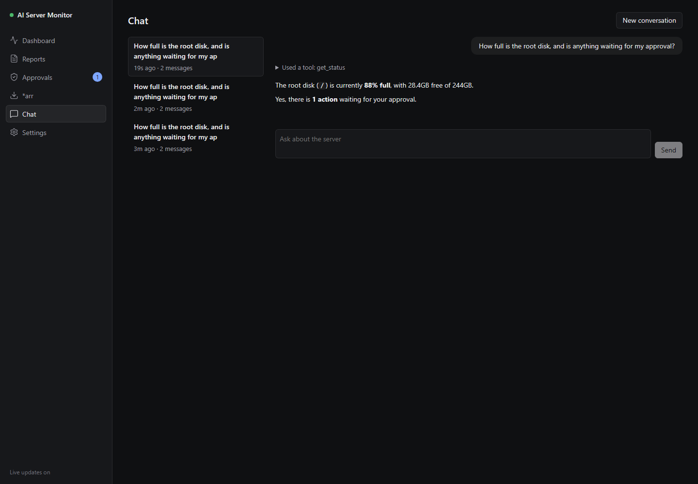

# AI Server Monitor

An AI-powered, **read-only** monitor for one self-hosted Linux server. You ask questions in chat
(the web Chat page, Telegram, or the `/api/chat` endpoint) and one LLM agent, behind any
OpenAI-compatible API, finds the answer itself: it runs read-only shell commands on the host (a
`bash` tool in a sandbox), can hand sub-tasks to a smaller worker model, and uses the tools of the
MCP servers you add. The monitor collects nothing by code on its own; everything it knows comes
from what the model looks at. Every write goes through a per-action policy (`off`, `suggest`,
`approve`, `auto`), rate limits and a permanent audit log; the host itself is only ever read. `/metrics`
exposes the monitor's own counters for Grafana.

**The model must support native tool calling** (OpenAI-style `tools`). A model that cannot call tools
cannot run the product; Settings → LLM → **Test** checks the endpoint, the model and one tool-call
round trip.



- [Install](#install) · [First run](#first-run-walkthrough) · [Using it](#using-it)
- [LLM recommendations](#llm-recommendations) · [Security and the approval model](#security-and-the-approval-model)
- [Settings reference](#settings-reference) · [Troubleshooting](#troubleshooting)
- [Development](#development) · [Releasing](#releasing) · [Design notes](docs/DESIGN.md)

## Install

Debian/Ubuntu (or any Linux) host with Docker and the compose plugin:

```bash
mkdir -p ~/ai-server-monitor && cd ~/ai-server-monitor
curl -fsSL https://raw.githubusercontent.com/drumslave-git/ai-server-monitor/main/docker/compose.example.yaml -o compose.yaml
docker compose up -d
```

Open `http://<server>:8080`. Everything else is configured in the web UI under **Settings**;
changes apply immediately and there are no config files.

What the compose file sets, and why:

| Part | Why |
|---|---|
| `./data:/data` | Settings and history (one SQLite file). **Back it up: it contains your API keys and tokens in clear text.** |
| `pid: host` | Lets the container see the host's processes (`ps`, `top`). |
| `/:/host:ro,rslave` | A read-only view of the host's filesystem: what the chat's shell reads: disk usage of the real mounts, package state, logs. Nothing is ever written there. |
| `security_opt: apparmor=unconfined` | On hosts with AppArmor (Ubuntu) Docker's default profile blocks reading other processes. The mounts stay read-only. Hosts without AppArmor do not need it. |
| `cap_add: [DAC_READ_SEARCH]` | The chat's `bash` tool runs real bash on the host's files and programs (`chroot /host`, then the host's `setpriv`/`prlimit`/`ionice`) as a dedicated unprivileged uid that owns no host process, with no_new_privs and only this capability: it can read every file, write none, signal nothing, and cannot open the real Docker socket (`docker` goes through the read-only proxy). Without this line the shell still works as a plain unprivileged user and says when root-only paths were unreadable. Needs Docker's default `CHROOT`/`SETUID`/`SETGID` (no `cap_drop: ALL`). Every command is logged (`GET /api/chat/audit`). |
| `DOCKER_HOST: tcp://docker-proxy:2375` | The Docker API goes through a socket proxy that only allows GET requests. The monitor can look at containers and images, not start, stop or delete anything. |
| `docker-proxy` env `CONTAINERS`, `IMAGES`, `INFO`, `SYSTEM` | The API sections the proxy lets through: containers (state, stats, logs), images, engine info, and disk usage (`/system/df`). |
| `# gpus: all` | Uncomment to make an NVIDIA GPU visible to the shell (needs the NVIDIA container runtime on the host). |

Startup parameters that are not settings (the image defaults are right for the compose file):
`ASM_DATA_DIR` (`/data`), `ASM_PORT` (`8080`), `ASM_HOST` (`0.0.0.0`), `ASM_HOST_ROOT` (`/host`),
`ASM_STATIC_DIR` (the built web UI, set in the image).

**There is no built-in login.** Keep port 8080 on your LAN, or put a reverse proxy with
authentication in front of it (Authelia, oauth2-proxy, basic auth, Cloudflare Access...). The UI,
the API (including the approval endpoints) and chat are all behind the same door, so whoever can
reach the port can approve actions. If you expose `/metrics` to a Prometheus on another network,
set a bearer token for it (below). The live endpoints `/api/stream` and `/api/chat` are
server-sent events; they send `X-Accel-Buffering: no`, and if your proxy still buffers them,
disable response buffering for those two paths.

Update: `docker compose pull && docker compose up -d`. To pin a version, change the image tag
(`ghcr.io/drumslave-git/ai-server-monitor:X.Y.Z`; tags `X.Y.Z`, `X.Y` and `latest`, amd64). If the
GHCR package is private, `docker login ghcr.io` with a token that has `read:packages`.

## First run walkthrough

Open **Settings**. The sections are tabs; **Save** applies the change without a restart. A bad
value is shown next to the field and nothing is saved until it is fixed.
Every connection (LLM, Telegram) has a **Test**
button that checks what you typed, before you save, and says what answered or what is wrong.

1. **LLM** (`llm`) — the one thing the monitor cannot work without. The model must support native
   tool calling.
   - *Base URL*: any OpenAI-compatible endpoint ending in `/v1`: `http://ollama:11434/v1`,
     `http://llama:8080/v1`, `https://openrouter.ai/api/v1`, `https://api.openai.com/v1`.
   - *Model*: the name the endpoint knows (`gemma4:e4b`, `qwen2.5:14b`, `gpt-4o-mini`...).
     *API key* only if the endpoint wants one.
   - *Max output tokens*: keep it at **4096 or more**. Thinking models spend part of the budget on
     reasoning before the answer; a small limit gives empty or cut-off answers.
   - Press **Test**: it checks the endpoint, the model and one tool-call round trip.
   - A second, smaller *worker* model can be set; the main model hands it sub-tasks.
2. **General** (`general`) — *Language* of chat answers, the log level, and the Docker API address
   (`docker_url`; empty = `$DOCKER_HOST` from the compose file).
3. **Outputs** (`outputs`):
   - *Telegram*: create a bot with [@BotFather](https://t.me/BotFather) (`/newbot`), paste the token.
     Press **Test** to check the token (it shows the bot's name). To find your chat id, open the
     bot in Telegram and send `/id`: it answers in any chat with the chat id, your user id and the
     chat type. Add the chat id to *Allowed chat ids*, save, and the bot answers. **Send test
     message** then sends a short message to every allowed chat and reports each one (a chat that
     never pressed *Start* fails with "chat not found"). Apart from `/id`, chats that are not on
     the list are ignored without a reply.
   - *Metrics*: `/metrics` is on by default. Set a *Bearer token* if anything outside your trusted
     network can reach the port.
4. **Data retention** (`storage`): history and chats are kept 30 days by default; the
   action audit log is never pruned.

## Using it

- **Approvals** — what is waiting for your decision, with the
  audit log. **Chat** — ask questions about the server, with
  conversation history, streamed answers and approval cards for changes
  (screenshot: `docs/samples/ui/chat-desktop.png`). **Logs** — every request to the language
  model exactly as sent and received (the full messages, tool definitions, answer, reasoning, tool
  calls, token counts and timings: queue, time to first token, generation), a timeline per chat
  question (LLM call → tool → LLM call → answer) and the app's own log with a live tail
  (screenshots: `docs/samples/ui/logs-*.png`). Each chat answer links to its
  calls. Passwords, keys and tokens are removed from what is stored; retention and size limits
  are in Settings → Logs.
- **Pause automation** — the button at the top of every page stops every scheduled job and automation (approval sweeps, pruning) and cancels the runs in flight. Chat, approving/rejecting, the Settings test buttons and the Telegram bot keep working. It survives a restart; Resume lets the jobs come due again (the overdue ones start a couple of seconds apart). `GET /api/automation`, `POST /api/automation/pause|resume`; `/api/info` shows it per job.
- **Telegram** — write a plain question to chat
  ("what is using the most disk and memory?"); the model looks at the host with its read-only
  shell and answers. Commands: `/approvals` (open requests, with buttons), `/id` (this chat's id: works in any chat, also for
  chats that are not allowed yet, once per 10 s), `/new` (start a fresh chat), `/help`. When an
  action needs approval, the bot sends
  ONE message per approval (all the items one chat turn asked for: the
  first ten are listed, then "+N more") with **Approve all**, **Reject all** and, when
  `outputs.telegram.web_url` is set, **Review** (opens the approval in the web UI). Requests of the
  same run that arrive within 30 s end up in the same message. The message is edited to the
  outcome ("Approved by @name: 37 executed, 2 failed"), also when you decide in the
  web UI.
  Each Telegram chat is one conversation; the model sees only its last
  `chat.history_messages` (12) messages. A fresh conversation starts with `/new` or by itself after
  `outputs.telegram.new_session_after` (6 h) without a message (0 = never); the older ones stay in
  the web Chat list with their titles. Chat messages older than `storage.retention` (30 d) are
  deleted, also from a conversation still in use, and conversations left empty are removed.
- **Chat API** — `POST /api/chat` with `{"message": "...", "session_id": "..."}` answers as a
  server-sent-event stream (`session`, `tool_call`, `tool_result`, `token`, `done`);
  `GET /api/chat/sessions[/{id}]` and `DELETE /api/chat/sessions/{id}` manage the history.
  Chat can ask for changes through MCP tools but only through the
  same policy and approval path as everything else.
- **Metrics** — `/metrics` exposes LLM request and token counters, pending approvals, action counts,
  the status, last run time, duration and findings of every scheduled job (`asm_job_*`) and build
  info (`asm_*`). A Grafana dashboard to import is in [docs/grafana-dashboard.json](docs/grafana-dashboard.json).
  Scrape config:

  ```yaml
  scrape_configs:
    - job_name: ai-server-monitor
      authorization: { credentials: "<bearer token>" }   # only if you set one
      static_configs: [{ targets: ["ai-server-monitor:8080"] }]
  ```

## LLM recommendations

- **Native tool calling is required.** The chat agent works by calling tools (the host shell,
  `delegate`, MCP tools). There is no fallback for models that cannot call tools natively; the
  Settings Test button tells you whether yours can.
- **Local, small**: tested with `gemma4:e4b` through Ollama at `https://.../v1`. It uses native tool
  calling, and chat questions that need one or two tool calls were answered in about 5 to 15
  seconds in our tests. It needs the 4096 output tokens mentioned above. With Ollama also raise
  `OLLAMA_CONTEXT_LENGTH`, or the server silently truncates long prompts.
- **Cloud models** (OpenAI, OpenRouter, any OpenAI-compatible gateway) work the same way
  and are the best choice for chat that has to use many tools. Remember that tool results
  (process names, container names, log excerpts, file contents) leave your network; secrets are
  scrubbed from them first, but check that you are comfortable with the rest.

## Security and the approval model

- **The host is read-only**: read-only mounts, a GET-only Docker proxy, no write path to anything
  but the MCP servers you add.
- **Secrets**: API keys and tokens are stored in clear text in the SQLite file under `data/`
  (protect that directory like a credentials store) and are shown as `********` in the API and the
  UI. They are never sent to the LLM: tool results are scrubbed of configured secrets, secret-looking
  fields and common credential formats, and capped in size before the model sees them.
- **Untrusted text**: log lines, container output and tool results can say anything.
  They are passed to the model as clearly delimited data, and **no write can happen because of text**:
  a model can only *request* an action, and what happens is decided by your settings.
- **Policies**, per MCP server and tool: `off` = never (the request is only logged), `suggest` = recorded and mentioned,
  never executed, `approve` = waits for your button press (expires after `approvals.approval_ttl`, default
  1 day), `auto` = executes by itself within the caps. Approvals are grouped: everything one
  chat turn asks for with the same action is ONE approval with a checklist
  on the Approvals page: approve or reject all of it, or only the items you tick. Every item
  keeps its own row in the audit log (linked by its approval number). The hourly cap is applied
  when items are executed; items beyond it stay approved as `queued` and run by themselves as the cap frees up (nobody is
  asked a second time; the card and the Telegram message show "10 executed, 30 queued, next in ~N min"). *Max per hour* limits how often an action
  may run, counted from the audit log.
- **Audit log**: every request and its outcome (`suggested`, `pending`, `approved`, `rejected`,
  `expired`, `executed`, `failed`, `queued`, `dry_run`) is kept permanently with who asked (`chat:<session>`, `telegram:<chat>`), who decided (`ui`, `telegram:<user>`, `policy`, `timeout`)
  and the result. Read it on the Approvals page or at `GET /api/actions`.
- **MCP servers** (Settings → MCP servers): the chat can use tools of remote MCP servers you add (Home
  Assistant, Grafana, your own), over Streamable HTTP or the older HTTP+SSE, with a bearer token or
  headers. No stdio servers (that would mean running arbitrary programs inside this container), and
  only *tools* are used, not a server's prompts or resources. You pick which tools the chat gets
  (press **Test**, tick them): small models break with dozens of tool definitions, so none is chosen
  by default, and above `mcp.max_inline_tool_tokens` the chat gets a generic list/call pair instead.
  A tool is *read* only if the server marks it `readOnlyHint` and you did not override it; reads run
  at once and are listed under `GET /api/chat/audit?kind=mcp`. Everything else is a *write*: it is
  requested through the action layer (`mcp_call`) with the server's policy (default `approve`, so
  "turn off the heating" becomes an approval card in the UI or Telegram), per-tool overrides, its own
  `mcp.dry_run` switch, and the permanent audit log. Tool results are untrusted data: capped,
  scrubbed of secrets and delimited like everything else.
- **Telegram** only serves the chat ids you list; button presses carry a signature, so a forged
  callback cannot approve anything. There is no web login: see [Install](#install).

## Settings reference

Generated from the code by `python scripts/gen_settings_docs.py --write` (run `--check` in CI to
catch drift). Durations are written like `30s`, `5m`, `6h`, `30d`, `1h30m`. Defaults are the values
a fresh install starts with.

<!-- settings-reference:start (generated by scripts/gen_settings_docs.py) -->

### General (`general`)

| Setting | Type | Default | What it does |
|---|---|---|---|
| `general.log_level` | debug / info / warning / error | `info` | Log verbosity of the service. |
| `general.language` | string | `en` | Language of chat answers and Telegram messages. |
| `general.docker_url` | string | empty | Docker API the shell's `docker` commands use, e.g. tcp://docker-proxy:2375 or unix:///var/run/docker.sock. Empty = $DOCKER_HOST (set by the compose file), else the local socket. |
| `general.timezone` | string | empty | Time zone of cron schedules, e.g. Europe/Berlin. Empty = the host's own time zone (its /etc/timezone or /etc/localtime), UTC when that cannot be read. |

### Main model (`llm`)

| Setting | Type | Default | What it does |
|---|---|---|---|
| `llm.base_url` | string | empty | OpenAI-compatible API base URL, e.g. http://ollama:11434/v1, http://llama:8080/v1, https://openrouter.ai/api/v1. Empty = LLM not configured. |
| `llm.api_key` | secret | empty | API key, if the endpoint needs one. |
| `llm.model` | string | empty | Model name as the endpoint knows it, e.g. qwen2.5:14b or gpt-4o-mini. |
| `llm.max_output_tokens` | integer (min 64) | `16384` | Maximum tokens per answer, counting a thinking model's reasoning too. Too low and a model that thinks long runs out before it writes the answer (shown as an error). |
| `llm.reasoning_effort` | auto / none / low / medium / high | `auto` | How much a thinking model reasons before answering chat questions, sent as the API's reasoning_effort (left out from then on if the endpoint rejects it). auto = not sent, the model decides; none = no thinking (fast, shallower); low / medium / high = as the model supports. Short helper calls (chat titles, tests) always ask for none. |
| `llm.temperature` | number or auto | `auto` | Randomness of answers: 0 is the most predictable, higher is more varied. auto = not sent, so the model's own default applies (for Ollama models it is shown above). |
| `llm.top_p` | number or auto | `auto` | Nucleus sampling: only the most likely words that together cover this share of the probability are considered. auto = not sent, the model's own default applies. |
| `llm.top_k` | integer or auto | `auto` | Only the this-many most likely words are considered at each step (0 = no limit). auto = not sent, the model's own default applies. Not every endpoint honours it. |
| `llm.timeout` | duration | `3m` | Per-request timeout. Local models on CPU can be slow. |
| `llm.max_retries` | integer (min 0, max 10) | `2` | How many times a failed model request is retried before giving up. |
| `llm.extra_body` | map | empty | Extra provider-specific request fields (JSON), passed through verbatim. |

### Worker model (`worker`)

| Setting | Type | Default | What it does |
|---|---|---|---|
| `worker.base_url` | string | empty | OpenAI-compatible API base URL, e.g. http://ollama:11434/v1, http://llama:8080/v1, https://openrouter.ai/api/v1. Empty = LLM not configured. |
| `worker.api_key` | secret | empty | API key, if the endpoint needs one. |
| `worker.model` | string | empty | Model name as the endpoint knows it, e.g. qwen2.5:14b or gpt-4o-mini. |
| `worker.max_output_tokens` | integer (min 64) | `16384` | Maximum tokens per answer, counting a thinking model's reasoning too. Too low and a model that thinks long runs out before it writes the answer (shown as an error). |
| `worker.reasoning_effort` | auto / none / low / medium / high | `auto` | How much a thinking model reasons before answering chat questions, sent as the API's reasoning_effort (left out from then on if the endpoint rejects it). auto = not sent, the model decides; none = no thinking (fast, shallower); low / medium / high = as the model supports. Short helper calls (chat titles, tests) always ask for none. |
| `worker.temperature` | number or auto | `auto` | Randomness of answers: 0 is the most predictable, higher is more varied. auto = not sent, so the model's own default applies (for Ollama models it is shown above). |
| `worker.top_p` | number or auto | `auto` | Nucleus sampling: only the most likely words that together cover this share of the probability are considered. auto = not sent, the model's own default applies. |
| `worker.top_k` | integer or auto | `auto` | Only the this-many most likely words are considered at each step (0 = no limit). auto = not sent, the model's own default applies. Not every endpoint honours it. |
| `worker.timeout` | duration | `3m` | Per-request timeout. Local models on CPU can be slow. |
| `worker.max_retries` | integer (min 0, max 10) | `2` | How many times a failed model request is retried before giving up. |
| `worker.extra_body` | map | empty | Extra provider-specific request fields (JSON), passed through verbatim. |

### Chat (`chat`)

| Setting | Type | Default | What it does |
|---|---|---|---|
| `chat.max_steps` | integer (min 1, max 60) | `15` | Most tool-use rounds of the main model per question before it must answer with what it has. A host question usually takes 3 to 8 shell commands; the rest is room for a check. |
| `chat.worker_max_steps` | integer (min 1, max 60) | `20` | Most tool-use rounds of one sub-task on the worker model. Higher than the main model's: a small model exploring with the shell needs more tries, and its steps are cheap. |
| `chat.command_timeout` | duration | `5m` | How long one shell command may run when the model does not ask for longer (it may ask for up to the tool time limit below, e.g. for a disk walk). |
| `chat.history_messages` | integer (min 0, max 100) | `12` | How many earlier messages of a conversation the model sees. |
| `chat.max_tool_result_chars` | integer (min 500, max 50000) | `6000` | Longest tool result passed to the model; bigger results are trimmed. |
| `chat.tool_timeout` | duration | `1h` | Longest one tool call (a disk scan, a command, an API call) may run before the chat gives up on it. The answer waits for the tool; the chat shows what is running and for how long. |

### Jobs (`jobs`)

| Setting | Type | Default | What it does |
|---|---|---|---|
| `jobs.max_concurrent_runs` | integer (min 1, max 8) | `1` | How many job runs may use the models at the same time. 1 suits one local GPU: runs that come due together wait for each other. |
| `jobs.timeout` | duration | `15m` | Longest one job run may take (a job can set its own). A run over it is stored as error. |
| `jobs.max_steps` | integer (min 1, max 60) | `12` | Most tool-use rounds of one job run (a job can set its own). |

### Data retention (`storage`)

| Setting | Type | Default | What it does |
|---|---|---|---|
| `storage.retention` | duration | `30d` | How long chat messages and job runs are kept. The action log is permanent. |
| `storage.prune_interval` | duration | `1h` | How often old data is deleted. |

### Logs (`logs`)

| Setting | Type | Default | What it does |
|---|---|---|---|
| `logs.llm_trace` | boolean | on | Record every request to the language model: what was sent, what came back, how long it took. Shown on the Logs page. Off = new calls are not recorded. |
| `logs.store_bodies` | boolean | on | Keep the full text of prompts, tool definitions, answers and reasoning. Off = only the numbers are kept (timings, token counts, status), and the page cannot show what was sent. Passwords, API keys and tokens are removed from stored text either way. |
| `logs.retention` | duration | `7d` | How long recorded calls and saved warnings stay. |
| `logs.max_total_mb` | integer (min 10, max 10000) | `200` | Upper limit for the recorded calls on disk; the oldest go first when it is exceeded. |
| `logs.keep_app_log` | boolean | on | Save warnings and errors of the app log in the database so they survive a restart. The Logs page always shows the newest few thousand lines since the last start. |

### Outputs (`outputs`)

| Setting | Type | Default | What it does |
|---|---|---|---|
| `outputs.telegram.enabled` | boolean | off | Turn the Telegram bot on (needs a bot token and at least one allowed chat id). |
| `outputs.telegram.token` | secret | empty | Bot token from @BotFather. |
| `outputs.telegram.allowed_chat_ids` | list of integer | empty | Only these chats may talk to the bot. Don't know a chat id? Send /id to the bot: it answers in any chat. |
| `outputs.telegram.new_session_after` | duration | `6h` | Start a fresh chat after this long without a message in a Telegram chat (the old one stays in the Chat list on the web page). 0 = never: one chat until you send /new. |
| `outputs.telegram.api_url` | string | empty | Bot API server. Empty = https://api.telegram.org. |
| `outputs.telegram.web_url` | string | empty | Address of this web UI as you open it, e.g. https://monitor.example.com. Approval messages get a "Review" button that opens the approval there. Empty = no button. |
| `outputs.metrics.enabled` | boolean | on | Expose Prometheus metrics at /metrics. |
| `outputs.metrics.bearer_token` | secret | empty | If set, scrapers must send "Authorization: Bearer &lt;token>" (Prometheus: authorization in the scrape config). Empty = open to anyone who can reach the port. |

### MCP servers (`mcp`)

| Setting | Type | Default | What it does |
|---|---|---|---|
| **mcp.servers** | list of groups | empty | MCP servers whose tools the chat may use (tools only: prompts and resources of a server are not used). |
| `mcp.servers[].name` | string | required | Short name shown in chat and in tool names, e.g. home-assistant. |
| `mcp.servers[].enabled` | boolean | on | Off = never connected, its tools are not offered. |
| `mcp.servers[].url` | string | required | MCP endpoint, e.g. http://homeassistant.local:8123/mcp_server/sse or https://grafana.example/mcp. Remote servers only (Streamable HTTP or the older HTTP+SSE); servers that run as a local program (stdio) are not supported. |
| `mcp.servers[].transport` | auto / streamable_http / sse | `auto` | auto = try Streamable HTTP, fall back to the older HTTP+SSE. |
| `mcp.servers[].token` | secret | empty | Bearer token sent as `Authorization: Bearer ...`, if the server needs one. |
| **mcp.servers[].headers** | list of groups | empty | Extra HTTP headers (for servers that want an API key header instead of a token). |
| `mcp.servers[].headers[].name` | string | required | Header name, e.g. X-Api-Key. |
| `mcp.servers[].headers[].value` | secret | required | Header value (kept secret, like the token). |
| `mcp.servers[].timeout` | duration | `30s` | Connect timeout and per-call timeout. |
| `mcp.servers[].tool_filter` | list of string | empty | The tools the chat may use. Empty = none: pick them after pressing Test (small models cope badly with dozens of tools, so choose only what you need). |
| `mcp.servers[].default_policy` | off / suggest / approve / auto | `approve` | For tools that change things: off = never; suggest = only record the request; approve = ask you first (UI / Telegram); auto = just do it. Read-only tools always run. |
| **mcp.servers[].tool_overrides** | list of groups | empty | Per-tool exceptions to the policy or to the read-only detection. |
| `mcp.servers[].tool_overrides[].name` | string | required | Tool name as the server calls it. |
| `mcp.servers[].tool_overrides[].policy` | inherit / off / suggest / approve / auto | `inherit` | inherit = the server's default policy; off = the chat does not get this tool at all; suggest / approve / auto as for the server (only used for tools that change things). |
| `mcp.servers[].tool_overrides[].kind` | auto / read / write | `auto` | auto = read-only only if the server says so; read / write = your own call. A tool treated as read runs immediately; a write goes through the action policy. |
| `mcp.max_inline_tool_tokens` | integer (min 0) | `1200` | If the schemas of all chosen tools together are bigger than this (about 4 characters per token), the chat gets two generic tools (list tools / call tool) instead of one tool per MCP tool. Small models do better with fewer schemas. 0 = always use the generic pair. |
| `mcp.dry_run` | boolean | off | Pretend: record write calls in the action log but send nothing to the servers. |

### Approvals (`approvals`)

| Setting | Type | Default | What it does |
|---|---|---|---|
| `approvals.approval_ttl` | duration | `1d` | Pending approvals expire after this. |

<!-- settings-reference:end -->

## Troubleshooting

- **Chat says the shell cannot run, or an answer is empty** — Settings → LLM → **Test** first; it
  checks the endpoint, the model and a tool-call round trip. Thinking models need
  *Max output tokens* of 4096 or more.
- **Chat: "the host lacks setpriv" / root-only paths unreadable** — the sandbox uses the host's own
  util-linux tools (`setpriv`, `prlimit`, `ionice`); install them on the host. For root-only paths add
  `cap_add: [DAC_READ_SEARCH]` to the ai-server-monitor service (the shell's output says so).
- **Not sure a connection is right?** Every connection in Settings (LLM, Telegram) has a **Test** button that checks the values you typed
  *before* you save: it names the app and version that answered, or says what is wrong (wrong
  key, DNS name not found, timeout, TLS error).
- **Telegram does not answer** — your chat id must be in *Allowed chat ids*: send `/id` to the
  bot to see it, and use *Send test message* under Settings → Outputs → Telegram to check each
  chat. `docker logs` shows polling errors without the token.
- **An approval or action does nothing** — with `mcp.dry_run` on, approved calls only log what they
  would have done (status `dry_run`).

## Development

```bash
cd backend && python -m venv .venv && .venv/bin/pip install -e ".[dev]"   # Windows: .venv\Scripts\pip
.venv/bin/pytest && .venv/bin/ruff check . && .venv/bin/ruff format --check .
ASM_DATA_DIR=./data .venv/bin/python -m ai_server_monitor                 # API on :8080
cd ../frontend && npm install && npm run dev                                # UI on :5173, proxies /api
```

Local image: `docker build -f docker/Dockerfile -t ai-server-monitor:dev .`

The settings reference above is generated: after changing `backend/ai_server_monitor/config.py`
run `python scripts/gen_settings_docs.py --write`.

## Releasing

The version in `backend/pyproject.toml` is the release trigger.

```bash
python scripts/release.py patch     # or minor / major / X.Y.Z — also syncs frontend/package.json
git commit -am "Release vX.Y.Z" && git push
```

On push to `main`, the **Release** workflow checks whether the current version has a tag yet;
if not, it runs CI, publishes the image to GHCR and then tags `vX.Y.Z`. A failed release is
retried by the next push. Pushes without a version bump publish nothing.
You can also trigger it via Actions → Release → *Run workflow*.
**CI** (lint, tests, frontend build) runs on every push and pull request.
