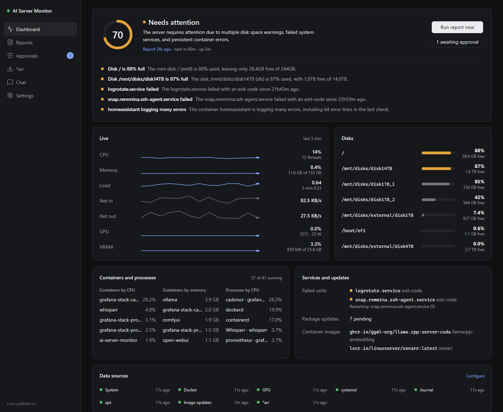

# AI Server Monitor

An AI-powered, **read-only** monitor for one self-hosted Linux server. It collects host data
(CPU, memory, disks, network, processes, Docker, image updates, apt updates, NVIDIA GPU,
systemd, journal, Prometheus, \*arr/qBittorrent), turns it into a compact digest, and has an LLM
behind any OpenAI-compatible API write a status report every few minutes. You read the reports
in the web dashboard or in Telegram, ask questions in chat (the web Chat page, Telegram, or the
`/api/chat` endpoint), and scrape `/metrics` into Grafana. Optionally it automates the \*arr stack
(Radarr, Sonarr, Whisparr, Prowlarr) and qBittorrent: stalled-download cleanup, missing and
upgrade searches, indexer tests, adding media on request. Every one of those writes goes
through a per-action policy (`off`, `suggest`, `approve`, `auto`), a global dry-run switch,
rate limits and a permanent audit log; the host itself is only ever read.



- [Install](#install) · [First run](#first-run-walkthrough) · [Using it](#using-it)
- [LLM recommendations](#llm-recommendations) · [Security and the approval model](#security-and-the-approval-model)
- [Settings reference](#settings-reference) · [Troubleshooting](#troubleshooting)
- [Development](#development) · [Releasing](#releasing) · [Design notes](docs/DESIGN.md)

## Install

Debian/Ubuntu (or any Linux) host with Docker and the compose plugin:

```bash
mkdir -p ~/ai-server-monitor && cd ~/ai-server-monitor
curl -fsSL https://raw.githubusercontent.com/drumslave-git/ai-server-monitor/main/docker/compose.example.yaml -o compose.yaml
docker compose up -d
```

Open `http://<server>:8080`. Everything else is configured in the web UI under **Settings**;
changes apply immediately and there are no config files.

What the compose file sets, and why:

| Part | Why |
|---|---|
| `./data:/data` | Settings and history (one SQLite file). **Back it up: it contains your API keys and tokens in clear text.** |
| `pid: host` | Lets the container see the host's processes (top CPU/memory consumers, which container a process belongs to). |
| `/:/host:ro,rslave` | A read-only view of the host's filesystem: disk usage of the real mounts, the apt state, the journal, the systemd D-Bus socket. Nothing is ever written there. |
| `security_opt: apparmor=unconfined` | On hosts with AppArmor (Ubuntu) Docker's default profile blocks the systemd D-Bus queries and reading other processes. The mounts stay read-only. Hosts without AppArmor do not need it. |
| default container capabilities | The chat's `run_command` tool chroots into `/host` and drops to the host's unprivileged `nobody` user, which needs `CAP_SYS_CHROOT`, `CAP_SETUID` and `CAP_SETGID` (Docker's defaults; do not use `cap_drop: ALL`). The commands run read-only with no capabilities, limited CPU/memory/time, and every one is logged (`GET /api/chat/audit`). Turn it off with Settings → Chat → `shell`. |
| `DOCKER_HOST: tcp://docker-proxy:2375` | The Docker API goes through a socket proxy that only allows GET requests. The monitor can look at containers and images, not start, stop or delete anything. |
| `docker-proxy` env `CONTAINERS`, `IMAGES`, `INFO`, `SYSTEM` | The API sections the proxy lets through: containers (state, stats, logs), images (needed by the image-update check), engine info, and disk usage (`/system/df`). |
| `# gpus: all` | Uncomment for NVIDIA GPU monitoring (needs the NVIDIA container runtime on the host). |

Startup parameters that are not settings (the image defaults are right for the compose file):
`ASM_DATA_DIR` (`/data`), `ASM_PORT` (`8080`), `ASM_HOST` (`0.0.0.0`), `ASM_HOST_ROOT` (`/host`),
`ASM_STATIC_DIR` (the built web UI, set in the image).

**There is no built-in login.** Keep port 8080 on your LAN, or put a reverse proxy with
authentication in front of it (Authelia, oauth2-proxy, basic auth, Cloudflare Access...). The UI,
the API (including the approval endpoints) and chat are all behind the same door, so whoever can
reach the port can approve actions. If you expose `/metrics` to a Prometheus on another network,
set a bearer token for it (below). The live endpoints `/api/stream` and `/api/chat` are
server-sent events; they send `X-Accel-Buffering: no`, and if your proxy still buffers them,
disable response buffering for those two paths.

Update: `docker compose pull && docker compose up -d`. To pin a version, change the image tag
(`ghcr.io/drumslave-git/ai-server-monitor:X.Y.Z`; tags `X.Y.Z`, `X.Y` and `latest`, amd64). If the
GHCR package is private, `docker login ghcr.io` with a token that has `read:packages`.

## First run walkthrough

Open **Settings**. The sections are tabs; **Save** applies the change without a restart. A bad
value is shown next to the field and nothing is saved until it is fixed.
Every connection (LLM, Prometheus, Docker, each \*arr app, qBittorrent, Telegram) has a **Test**
button that checks what you typed, before you save, and says what answered or what is wrong.

1. **LLM** (`llm`) — the one thing the monitor cannot work without.
   - *Base URL*: any OpenAI-compatible endpoint ending in `/v1`: `http://ollama:11434/v1`,
     `http://llama:8080/v1`, `https://openrouter.ai/api/v1`, `https://api.openai.com/v1`.
   - *Model*: the name the endpoint knows (`gemma4:e4b`, `qwen2.5:14b`, `gpt-4o-mini`...).
     *API key* only if the endpoint wants one.
   - *Max output tokens*: keep it at **4096 or more**. Thinking models spend part of the budget on
     reasoning before the answer; a small limit gives empty or cut-off reports.
   - *Max context tokens*: the context window you actually run with. With Ollama also raise
     `OLLAMA_CONTEXT_LENGTH`, or the server silently truncates long prompts.
   - Press **Test connection**: it lists the endpoint's models and sends a tiny request.
2. **Reports** (`report`) — *Interval* (default 5 minutes), *Language* of reports and chat
   answers, and the thresholds the digest uses to flag problems (disk, memory, load...). The first
   report is written about 45 seconds after startup, once the collectors have run.
3. **Collectors** (`collectors`) — everything is on by default and a collector that cannot work on
   your host reports "unavailable" instead of failing. Check the **Dashboard** for the state of each.
   - *Prometheus*: set the URL (e.g. `http://prometheus:9090`); it turns on by itself
     (`enabled: auto`). Add queries with name, PromQL and a description of what the result means; two
     generic ones ship (`up == 0`, firing alerts). Optional bearer token or basic auth.
     **Automatic queries** (on by default): the LLM reads what your Prometheus scrapes (one small request
     per job) and picks queries that add to what the monitor already sees — other exporters, error and
     saturation counters, other machines. Every query is run against Prometheus first; failures are sent
     back to the model once, then dropped, and a model that fails leaves a few built-in checks. Chosen
     queries are stored and run with yours; the list under *Collectors → Prometheus* shows the last value
     or error and lets you switch off, pin or delete each one, or **Re-plan now** (it also re-plans when
     the set of metrics changes and weekly). A query that fails 5 runs in a row is switched off. Down
     targets and firing alerts are read straight from Prometheus and flagged without the model; results
     from another machine (e.g. a Windows exporter) are labelled "other host" in the digest.
   - *Image updates*: needs `IMAGES: 1` on the docker proxy. It compares each running container's image digest
     with what the registry serves for the same tag (anonymously; private images show as "unknown").
4. **\*arr & downloads** (`arr`) — add Radarr, Sonarr, Whisparr and Prowlarr instances (name, URL,
   API key from Settings → General in each app) and qBittorrent (URL, user, password). The `arr`
   collector then shows queues, health, missing/upgrade counts, failing indexers and stalled torrents.
   **Start safe:** leave *Dry run* **on** and the action policies on `suggest`. Dry run means
   nothing is sent to your apps, even after you approve; you see in the audit log what would have
   happened. Switch a policy to `approve` first, and `auto` only for things you trust (see
   [the approval model](#security-and-the-approval-model)). Turn *Dry run* off last.
5. **Outputs** (`outputs`):
   - *Telegram*: create a bot with [@BotFather](https://t.me/BotFather) (`/newbot`), paste the token.
     Press **Test** to check the token (it shows the bot's name). To find your chat id, open the
     bot in Telegram and send `/id`: it answers in any chat with the chat id, your user id and the
     chat type. Add the chat id to *Allowed chat ids*, save, and the bot answers. **Send test
     message** then sends a short message to every allowed chat and reports each one (a chat that
     never pressed *Start* fails with "chat not found"). Apart from `/id`, chats that are not on
     the list are ignored without a reply.
     *Report every* N reports (0 = only health-change alerts); *Alerts* sends a short message
     whenever the health status changes.
   - *Metrics*: `/metrics` is on by default. Set a *Bearer token* if anything outside your trusted
     network can reach the port.
6. **Data retention** (`storage`): history, reports and chats are kept 30 days by default; the
   action audit log is never pruned.

## Using it

- **Dashboard** — live health, key numbers, top consumers, collector states. **Reports** — history
  and the full text of each report. **Approvals** — what is waiting for your decision, with the
  audit log. **\*arr** — queues, indexers, torrents. **Chat** — ask questions about the server, with
  conversation history, streamed answers and approval cards for changes
  (screenshot: `docs/samples/ui/chat-desktop.png`). **Logs** — every request to the language
  model exactly as sent and received (the full messages, tool definitions, answer, reasoning, tool
  calls, token counts and timings: queue, time to first token, generation), a timeline per chat
  question (LLM call → tool → LLM call → answer) and the app's own log with a live tail
  (screenshots: `docs/samples/ui/logs-*.png`). Each report and each chat answer links to its
  calls. Passwords, keys and tokens are removed from what is stored; retention and size limits
  are in Settings → Logs.
- **Telegram** — reports and alerts arrive by themselves. Write a plain question to chat
  ("what is using the most disk and memory?"); the model looks at live data with read-only tools
  and answers. Commands: `/status` (health and open flags), `/report` (write one now),
  `/approvals` (open requests, with buttons), `/id` (this chat's id: works in any chat, also for
  chats that are not allowed yet, once per 10 s), `/new` (start a fresh chat), `/help`. When an
  action needs approval, the bot sends
  ONE message per approval (all the items one automation run, or one chat turn, asked for: the
  first ten are listed, then "+N more") with **Approve all**, **Reject all** and, when
  `outputs.telegram.web_url` is set, **Review** (opens the approval in the web UI). Requests of the
  same run that arrive within 30 s end up in the same message. The message is edited to the
  outcome ("Approved by @name: 37 executed, 2 failed"), also when you decide in the
  web UI.
  Each Telegram chat is one conversation; the model sees only its last
  `chat.history_messages` (12) messages. A fresh conversation starts with `/new` or by itself after
  `outputs.telegram.new_session_after` (6 h) without a message (0 = never); the older ones stay in
  the web Chat list with their titles. Chat messages older than `storage.retention` (30 d) are
  deleted, also from a conversation still in use, and conversations left empty are removed.
- **Chat API** — `POST /api/chat` with `{"message": "...", "session_id": "..."}` answers as a
  server-sent-event stream (`session`, `tool_call`, `tool_result`, `token`, `done`);
  `GET /api/chat/sessions[/{id}]` and `DELETE /api/chat/sessions/{id}` manage the history.
  Chat can ask for changes (add a movie, search, remove a stalled download) but only through the
  same policy and approval path as everything else.
- **Metrics** — `/metrics` exposes health score and status, findings, collector up/duration/errors,
  report and LLM counters, pending approvals, action counts and *arr/qBittorrent gauges
  (`asm_*`). A Grafana dashboard to import is in [docs/grafana-dashboard.json](docs/grafana-dashboard.json).
  Scrape config:

  ```yaml
  scrape_configs:
    - job_name: ai-server-monitor
      authorization: { credentials: "<bearer token>" }   # only if you set one
      static_configs: [{ targets: ["ai-server-monitor:8080"] }]
  ```

## LLM recommendations

- **Local, small**: tested with `gemma4:e4b` through Ollama at `https://…/v1`. It uses native tool
  calling, writes good reports, and chat questions that need one or two tool calls were answered in about 5 to 15 seconds in our tests. It needs the
  4096 output tokens mentioned above. Models in the 7–14B range work; the digest is built to fit
  them (`report.digest_token_budget`, default 3000 tokens).
- **How tools work**: with `llm.tool_mode: auto` the monitor probes the endpoint once (at startup,
  retried every few minutes until the LLM is reachable) and remembers the result for a week per
  endpoint and model: `native` (OpenAI tool calls), `json` (the model answers
  `{"tool": ..., "args": {...}}` as text; malformed replies get up to two repair prompts) or `none`
  (no tools; the current digest is put into the prompt instead). Override it with `llm.tool_mode`
  if the probe guesses wrong. The answer is streamed token by token in every mode.
- **Cloud models** (OpenAI, OpenRouter, any OpenAI-compatible gateway) work the same way
  and are the best choice for chat that has to use many tools. Remember that report digests and
  tool results (process names, container names, log excerpts) leave your network; secrets are
  scrubbed from them first, but check that you are comfortable with the rest.
- Reports are written from a pre-analysed digest, not from raw data, so even a small model does not
  need to find problems itself: the rules flag them, the model explains them.

## Security and the approval model

- **The host is read-only**: read-only mounts, a GET-only Docker proxy, no write path to anything
  but the *arr and qBittorrent APIs.
- **Secrets**: API keys and tokens are stored in clear text in the SQLite file under `data/`
  (protect that directory like a credentials store) and are shown as `********` in the API and the
  UI. They are never sent to the LLM: tool results are scrubbed of configured secrets, secret-looking
  fields and common credential formats, and capped in size before the model sees them.
- **Untrusted text**: log lines, container output, torrent names and *arr messages can say anything.
  They are passed to the model as clearly delimited data, and **no write can happen because of text**:
  a model can only *request* an action, and what happens is decided by your settings.
- **Policies**, per action group (stalled-download cleanup, missing search, upgrade search, add media,
  indexer tests): `off` = never (the request is only logged), `suggest` = recorded and mentioned,
  never executed, `approve` = waits for your button press (expires after `approval_ttl`, default
  1 day), `auto` = executes by itself within the caps. Approvals are grouped: everything one
  automation run (or one chat turn) asks for with the same action is ONE approval with a checklist
  on the Approvals page: approve or reject all of it, or only the items you tick. Every item
  keeps its own row in the audit log (linked by its approval number). The hourly cap is applied
  when items are executed; items beyond it stay approved as `queued` and run by themselves as the cap frees up (nobody is
  asked a second time; the card and the Telegram message show "10 executed, 30 queued, next in ~N min"). *Max per hour* limits how often an action group
  may run, counted from the audit log; searches also have a batch size.
- **Dry run** (on by default) is a global brake over all of it: nothing is sent to your apps; actions
  that would have run are logged with the status `dry_run`.
- **Not-owned torrents** are never removed automatically: a stalled torrent that no *arr owns (for
  example one you added by hand) is only ever suggested for removal.
- **Audit log**: every request and its outcome (`suggested`, `pending`, `approved`, `rejected`,
  `expired`, `executed`, `failed`, `queued`, `dry_run`) is kept permanently with who asked (`scheduler`,
  `chat:<session>`, `telegram:<chat>`), who decided (`ui`, `telegram:<user>`, `policy`, `timeout`)
  and the result. Read it on the Approvals page or at `GET /api/actions`.
- **MCP servers** (Settings → MCP servers): the chat can use tools of remote MCP servers you add (Home
  Assistant, Grafana, your own), over Streamable HTTP or the older HTTP+SSE, with a bearer token or
  headers. No stdio servers (that would mean running arbitrary programs inside this container), and
  only *tools* are used, not a server's prompts or resources. You pick which tools the chat gets
  (press **Test**, tick them): small models break with dozens of tool definitions, so none is chosen
  by default, and above `mcp.max_inline_tool_tokens` the chat gets a generic list/call pair instead.
  A tool is *read* only if the server marks it `readOnlyHint` and you did not override it; reads run
  at once and are listed under `GET /api/chat/audit?kind=mcp`. Everything else is a *write*: it is
  requested through the action layer (`mcp_call`) with the server's policy (default `approve`, so
  "turn off the heating" becomes an approval card in the UI or Telegram), per-tool overrides, its own
  `mcp.dry_run` switch, and the permanent audit log. Tool results are untrusted data: capped,
  scrubbed of secrets and delimited like everything else.
- **Telegram** only serves the chat ids you list; button presses carry a signature, so a forged
  callback cannot approve anything. There is no web login: see [Install](#install).

## Settings reference

Generated from the code by `python scripts/gen_settings_docs.py --write` (run `--check` in CI to
catch drift). Durations are written like `30s`, `5m`, `6h`, `30d`, `1h30m`. Defaults are the values
a fresh install starts with.

<!-- settings-reference:start (generated by scripts/gen_settings_docs.py) -->

### General (`general`)

| Setting | Type | Default | What it does |
|---|---|---|---|
| `general.log_level` | debug / info / warning / error | `info` | Log verbosity of the service. |

### LLM (`llm`)

| Setting | Type | Default | What it does |
|---|---|---|---|
| `llm.base_url` | string | empty | OpenAI-compatible API base URL, e.g. http://ollama:11434/v1, http://llama:8080/v1, https://openrouter.ai/api/v1. Empty = LLM not configured. |
| `llm.api_key` | secret | empty | API key, if the endpoint needs one. |
| `llm.model` | string | empty | Model name as the endpoint knows it, e.g. qwen2.5:14b or gpt-4o-mini. |
| `llm.tool_mode` | auto / native / json / none | `auto` | How the model calls tools in chat. auto = detect; native = OpenAI tool calls; json = JSON-in-text fallback for models without tool calling; none = no tools. |
| `llm.max_context_tokens` | integer (min 1024) | `8192` | Context window to plan prompts for. For Ollama, also raise OLLAMA_CONTEXT_LENGTH. |
| `llm.max_output_tokens` | integer (min 64) | `16384` | Maximum tokens per answer/report, counting a thinking model's reasoning too. Too low and a model that thinks long runs out before it writes the answer (shown as an error). |
| `llm.reasoning_effort` | auto / none / low / medium / high | `auto` | How much a thinking model reasons before answering chat questions and reports, sent as the API's reasoning_effort. auto = not sent, the model decides; none = no thinking (fast, shallower); low / medium / high = as the model supports. Short helper calls (chat titles, tool routing, tests) always ask for none. |
| `llm.temperature` | number or auto | `auto` | Randomness of answers: 0 is the most predictable, higher is more varied. auto = not sent, so the model's own default applies (for Ollama models it is shown above). |
| `llm.top_p` | number or auto | `auto` | Nucleus sampling: only the most likely words that together cover this share of the probability are considered. auto = not sent, the model's own default applies. |
| `llm.top_k` | integer or auto | `auto` | Only the this-many most likely words are considered at each step (0 = no limit). auto = not sent, the model's own default applies. Not every endpoint honours it. |
| `llm.timeout` | duration | `3m` | Per-request timeout. Local models on CPU can be slow. |
| `llm.max_retries` | integer (min 0, max 10) | `2` | How many times a failed model request is retried before giving up. |
| `llm.stream_usage` | boolean | on | Ask the endpoint for token usage while streaming (turned off automatically if the endpoint rejects it). |
| `llm.extra_body` | map | empty | Extra provider-specific request fields (JSON), passed through verbatim. |

### Reports (`report`)

| Setting | Type | Default | What it does |
|---|---|---|---|
| `report.interval` | duration | `5m` | How often the LLM writes a status report. |
| `report.skip_if_unchanged` | boolean | off | Skip the LLM call when nothing relevant changed since the last report. |
| `report.language` | string | `en` | Language of reports and chat answers. |
| `report.reasoning_effort` | auto / none / low / medium / high | `none` | Thinking level for reports (the API's reasoning_effort). A report is a summary of an already analysed digest, so none (no thinking) is fastest and most reliable: thinking models can loop in their reasoning for minutes and never write the report. auto = not sent, the model decides; low / medium / high = as the model supports. Chat uses LLM → reasoning effort. |
| `report.digest_token_budget` | integer (min 500, max 100000) | `3000` | Size limit (in tokens, ~4 characters each) of the pre-analyzed data digest the model reads. Over the limit, the least important sections are shortened or dropped first. Raise it for models with a big context, lower it for small ones. |
| `report.digest_top_n` | integer (min 1, max 20) | `5` | How many top processes, containers and disk writers the digest lists. |
| `report.trend_window` | duration | `7d` | How much stored history the digest uses for trends (disk growth, restarts). |
| `report.disk_warn_percent` | number (min 1, max 100) | `85` | A filesystem fuller than this is flagged as a warning. |
| `report.disk_crit_percent` | number (min 1, max 100) | `95` | A filesystem fuller than this is flagged as critical. |
| `report.disk_full_warn_days` | number | `14` | Warn when a disk's growth trend predicts it will be full within this many days. |
| `report.disk_full_crit_days` | number | `3` | Critical when a disk is predicted to be full within this many days. |
| `report.memory_warn_percent` | number (min 1, max 100) | `90` | Memory use (excluding cache) above this is a warning. |
| `report.memory_crit_percent` | number (min 1, max 100) | `97` | Memory use (excluding cache) above this is critical. |
| `report.swap_warn_percent` | number (min 1, max 100) | `50` | Swap use above this is a warning. |
| `report.load_warn_per_core` | number | `1.5` | 5-minute load average per CPU core above this is a warning. |
| `report.load_crit_per_core` | number | `3.0` | 5-minute load average per CPU core above this is critical. |
| `report.restart_loop_count` | integer (min 1) | `3` | A container or service restarted this many times within a day counts as a restart loop. |
| `report.log_error_burst` | integer (min 1) | `20` | This many error lines (journal in one report interval, or one container's log in one check) count as an error burst. |
| `report.gpu_temp_warn_c` | number (min 30) | `85` | A GPU hotter than this is a warning. |
| `report.unused_images_note_gb` | number (min 0) | `20` | Suggest pruning when this many GB of Docker images are unused while the disk holding Docker data is above the disk warning level. |

### Chat (`chat`)

| Setting | Type | Default | What it does |
|---|---|---|---|
| `chat.max_steps` | integer (min 1, max 20) | `6` | Most tool-use rounds per question before the model must answer with what it has. |
| `chat.history_messages` | integer (min 0, max 100) | `12` | How many earlier messages of a conversation the model sees. |
| `chat.max_tool_result_chars` | integer (min 500, max 50000) | `6000` | Longest tool result passed to the model; bigger results are trimmed. |
| `chat.tool_timeout` | duration | `1h` | Longest one tool call (a disk scan, a command, an API call) may run before the chat gives up on it. The answer waits for the tool; the chat shows what is running and for how long. |
| `chat.shell` | boolean | on | Let the chat run read-only commands on the host (journalctl, systemctl status, ss, df, ps, ...) to answer questions. They run in a sandbox as an unprivileged user and can change nothing. Off = the chat only sees the collected data. |
| `chat.disk_cache_ttl` | duration | `10m` | How long a finished disk scan of a path is reused. |
| `chat.tool_routing` | auto / always / off | `auto` | Send the model only the tool groups a question needs (host, media, metrics, containers, actions, one per MCP server). A short model call picks the groups before the answer; the model can load another group itself. auto = only when the full tool definitions are bigger than the token limit below (strong models cope with all tools); always = every question; off = every tool every time. |
| `chat.tool_routing_tokens` | integer (min 200, max 100000) | `2000` | With tool routing auto: the size of the tool definitions (about 4 characters per token) above which routing is used. |

### Data retention (`storage`)

| Setting | Type | Default | What it does |
|---|---|---|---|
| `storage.retention` | duration | `30d` | How long metrics history, reports and chat messages are kept. The action log is permanent. |
| `storage.sample_interval` | duration | `5m` | Resolution of stored history. Live data is always fresh. |
| `storage.prune_interval` | duration | `1h` | How often old data is deleted. |

### Logs (`logs`)

| Setting | Type | Default | What it does |
|---|---|---|---|
| `logs.llm_trace` | boolean | on | Record every request to the language model: what was sent, what came back, how long it took. Shown on the Logs page. Off = new calls are not recorded. |
| `logs.store_bodies` | boolean | on | Keep the full text of prompts, tool definitions, answers and reasoning. Off = only the numbers are kept (timings, token counts, status), and the page cannot show what was sent. Passwords, API keys and tokens are removed from stored text either way. |
| `logs.retention` | duration | `7d` | How long recorded calls and saved warnings stay. |
| `logs.max_total_mb` | integer (min 10, max 10000) | `200` | Upper limit for the recorded calls on disk; the oldest go first when it is exceeded. |
| `logs.keep_app_log` | boolean | on | Save warnings and errors of the app log in the database so they survive a restart. The Logs page always shows the newest few thousand lines since the last start. |

### Collectors (`collectors`)

| Setting | Type | Default | What it does |
|---|---|---|---|
| **collectors.system** | group |  | CPU, memory, disks, network, temperatures, top processes. |
| `collectors.system.enabled` | on / off / auto | on | auto = use it if available on this host, silently skip otherwise. |
| `collectors.system.interval` | duration | `15s` | How often this collector gathers fresh data. |
| `collectors.system.top_n` | integer (min 1, max 50) | `10` | How many top processes (by CPU and by memory) to report. |
| **collectors.docker** | group |  | Containers: state, health, restarts, resource use, log errors, disk usage. |
| `collectors.docker.enabled` | on / off / auto | on | auto = use it if available on this host, silently skip otherwise. |
| `collectors.docker.interval` | duration | `30s` | How often this collector gathers fresh data. |
| `collectors.docker.url` | string | empty | Docker API, e.g. tcp://docker-proxy:2375 or unix:///var/run/docker.sock. Empty = $DOCKER_HOST (set by the compose file), else the local socket. |
| `collectors.docker.log_scan` | boolean | on | Count error lines in container logs since the last run. |
| `collectors.docker.log_tail` | integer (min 10, max 5000) | `300` | Max log lines read per container per run. |
| `collectors.docker.df_interval` | duration | `30m` | How often to check Docker disk usage (images, volumes, build cache). |
| **collectors.gpu** | group |  | NVIDIA GPUs (needs the NVIDIA container runtime). |
| `collectors.gpu.enabled` | on / off / auto | `auto` | auto = use it if available on this host, silently skip otherwise. |
| `collectors.gpu.interval` | duration | `30s` | How often this collector gathers fresh data. |
| **collectors.systemd** | group |  | Failed units and restart loops. |
| `collectors.systemd.enabled` | on / off / auto | on | auto = use it if available on this host, silently skip otherwise. |
| `collectors.systemd.interval` | duration | `1m` | How often this collector gathers fresh data. |
| `collectors.systemd.bus_address` | string | empty | D-Bus address. Empty = the host's system bus under the host mount. |
| **collectors.journal** | group |  | Warnings and errors from the system journal. |
| `collectors.journal.enabled` | on / off / auto | on | auto = use it if available on this host, silently skip otherwise. |
| `collectors.journal.interval` | duration | `1m` | How often this collector gathers fresh data. |
| `collectors.journal.priority` | emerg / alert / crit / err / warning / notice / info | `warning` | Lowest severity to read. |
| `collectors.journal.directory` | string | empty | Journal directory. Empty = the host's /var/log/journal (or /run/log/journal). |
| `collectors.journal.max_entries` | integer (min 100, max 50000) | `2000` | Max entries read per run. |
| `collectors.journal.initial_lookback` | duration | `1h` | How far back to read after a (re)start. |
| **collectors.apt** | group |  | Pending package updates, security updates, reboot required. |
| `collectors.apt.enabled` | on / off / auto | on | auto = use it if available on this host, silently skip otherwise. |
| `collectors.apt.interval` | duration | `6h` | How often this collector gathers fresh data. |
| **collectors.image_updates** | group |  | Running containers whose image tag has a newer build in its registry (same tag, new digest; does not look for newer version numbers). |
| `collectors.image_updates.enabled` | on / off / auto | `auto` | auto = on when the Docker API is reachable. |
| `collectors.image_updates.interval` | duration | `12h` | How often this collector gathers fresh data. |
| `collectors.image_updates.url` | string | empty | Docker API, e.g. tcp://docker-proxy:2375. Empty = $DOCKER_HOST (set by the compose file), else the local socket. |
| `collectors.image_updates.cache_ttl` | duration | `6h` | How long a registry answer is reused. Registries rate-limit, so don't set this low. |
| **collectors.prometheus** | group |  | Run PromQL queries against an existing Prometheus. |
| `collectors.prometheus.enabled` | on / off / auto | `auto` | auto = on as soon as a URL is set. |
| `collectors.prometheus.interval` | duration | `1m` | How often this collector gathers fresh data. |
| `collectors.prometheus.url` | string | empty | Prometheus base URL, e.g. http://prometheus:9090. Empty = not used. |
| `collectors.prometheus.token` | secret | empty | Bearer token, if Prometheus sits behind an authenticating proxy. |
| `collectors.prometheus.username` | string | empty | Basic-auth user (used when no bearer token is set). |
| `collectors.prometheus.password` | secret | empty | Basic-auth password. |
| `collectors.prometheus.timeout` | duration | `10s` | Per-query timeout. |
| `collectors.prometheus.max_series` | integer (min 1, max 1000) | `50` | Max series kept per query result; the rest is only counted. |
| **collectors.prometheus.queries** | list of groups | empty | PromQL queries you wrote, run on every collection and included in reports. |
| `collectors.prometheus.queries[].name` | string | required | Short identifier shown in reports, e.g. targets_down. |
| `collectors.prometheus.queries[].query` | string | required | PromQL expression, evaluated as an instant query. |
| `collectors.prometheus.queries[].description` | string | empty | What the result means, e.g. "Scrape targets that are down". Helps the report writer. |
| `collectors.prometheus.queries[].unit` | string | empty | Unit of the value, e.g. %, bytes, seconds. Optional. |
| `collectors.prometheus.queries[].warn_if` | string | empty | Warning when a value crosses this: an operator and a number, e.g. > 80 or == 0. |
| `collectors.prometheus.queries[].crit_if` | string | empty | Critical when a value crosses this, same form as the warning. |
| `collectors.prometheus.auto_queries` | boolean | on | Let the LLM choose more queries from what this Prometheus scrapes (other exporters, errors, saturation, other hosts). Also reports firing alerts and down targets. The chosen queries are listed below and can be disabled, pinned, edited or deleted. |
| `collectors.prometheus.max_auto_queries` | integer (min 1, max 40) | `12` | Most automatically chosen queries. |
| `collectors.prometheus.replan_interval` | duration | `7d` | Choose queries again at least this often (also when the set of metrics changes). |
| **collectors.arr** | group |  | Radarr/Sonarr/Whisparr queues and health, Prowlarr indexers, qBittorrent torrents (the apps themselves are configured under \*arr & downloads). |
| `collectors.arr.enabled` | on / off / auto | `auto` | auto = on as soon as an \*arr app, Prowlarr or qBittorrent is configured under \*arr & downloads. |
| `collectors.arr.interval` | duration | `2m` | How often this collector gathers fresh data. |
| `collectors.arr.max_queue_items` | integer (min 1, max 500) | `50` | Max queue entries listed per \*arr instance (the rest is only counted). |

### Outputs (`outputs`)

| Setting | Type | Default | What it does |
|---|---|---|---|
| `outputs.telegram.enabled` | boolean | off | Turn the Telegram bot on (needs a bot token and at least one allowed chat id). |
| `outputs.telegram.token` | secret | empty | Bot token from @BotFather. |
| `outputs.telegram.allowed_chat_ids` | list of integer | empty | Only these chats may talk to the bot. Don't know a chat id? Send /id to the bot: it answers in any chat. |
| `outputs.telegram.report_every` | integer (min 0) | `1` | Send every Nth report (0 = alerts only). |
| `outputs.telegram.new_session_after` | duration | `6h` | Start a fresh chat after this long without a message in a Telegram chat (the old one stays in the Chat list on the web page). 0 = never: one chat until you send /new. |
| `outputs.telegram.alerts` | boolean | on | Send a short alert whenever the health status changes (also when reports are not sent every time). |
| `outputs.telegram.api_url` | string | empty | Bot API server. Empty = https://api.telegram.org. |
| `outputs.telegram.web_url` | string | empty | Address of this web UI as you open it, e.g. https://monitor.example.com. Approval messages get a "Review" button that opens the approval there. Empty = no button. |
| `outputs.metrics.enabled` | boolean | on | Expose Prometheus metrics at /metrics. |
| `outputs.metrics.bearer_token` | secret | empty | If set, scrapers must send "Authorization: Bearer &lt;token>" (Prometheus: authorization in the scrape config). Empty = open to anyone who can reach the port. |

### *arr & downloads (`arr`)

| Setting | Type | Default | What it does |
|---|---|---|---|
| `arr.dry_run` | boolean | on | Log what would be done without changing anything. |
| `arr.timeout` | duration | `15s` | Per-request timeout for \*arr, Prowlarr and qBittorrent. |
| **arr.radarr** | list of groups | empty |  |
| `arr.radarr[].name` | string | required | Display name, e.g. radarr-4k. |
| `arr.radarr[].url` | string | required | Base URL, e.g. http://radarr:7878. |
| `arr.radarr[].api_key` | secret | required | Settings → General → API Key in the app. |
| **arr.sonarr** | list of groups | empty |  |
| `arr.sonarr[].name` | string | required | Display name, e.g. radarr-4k. |
| `arr.sonarr[].url` | string | required | Base URL, e.g. http://radarr:7878. |
| `arr.sonarr[].api_key` | secret | required | Settings → General → API Key in the app. |
| **arr.whisparr** | list of groups | empty |  |
| `arr.whisparr[].name` | string | required | Display name, e.g. radarr-4k. |
| `arr.whisparr[].url` | string | required | Base URL, e.g. http://radarr:7878. |
| `arr.whisparr[].api_key` | secret | required | Settings → General → API Key in the app. |
| `arr.prowlarr.name` | string | required | Display name, e.g. radarr-4k. |
| `arr.prowlarr.url` | string | required | Base URL, e.g. http://radarr:7878. |
| `arr.prowlarr.api_key` | secret | required | Settings → General → API Key in the app. |
| `arr.qbittorrent.url` | string | required | WebUI URL, e.g. http://qbittorrent:8080. |
| `arr.qbittorrent.username` | string | `admin` | WebUI user name. |
| `arr.qbittorrent.password` | secret | empty | WebUI password. |
| **arr.actions.stalled_cleanup** | group |  | Remove stalled/failed downloads, blocklist the release and search again. |
| `arr.actions.stalled_cleanup.policy` | off / suggest / approve / auto | `approve` | off = never; suggest = mention in reports; approve = ask you first; auto = just do it. |
| `arr.actions.stalled_cleanup.max_per_hour` | integer (min 0) | `10` | Cap on how many downloads are cleaned up per hour (0 = no cap). |
| `arr.actions.stalled_cleanup.interval` | duration | `30m` | How often to look for stalled downloads. |
| `arr.actions.stalled_cleanup.stalled_after` | duration | `6h` | A download with no progress for this long counts as stalled. |
| **arr.actions.missing_search** | group |  | Search for missing episodes/movies. |
| `arr.actions.missing_search.policy` | off / suggest / approve / auto | `suggest` | off = never; suggest = mention in reports; approve = ask you first; auto = just do it. |
| `arr.actions.missing_search.max_per_hour` | integer (min 0) | `30` | Cap on how many searches run per hour (0 = no cap). |
| `arr.actions.missing_search.interval` | duration | `6h` | How often a search run starts. |
| `arr.actions.missing_search.batch` | integer (min 1) | `10` | Items searched per run (keeps indexers from being hammered). |
| **arr.actions.cutoff_search** | group |  | Search for quality upgrades (cutoff unmet). |
| `arr.actions.cutoff_search.policy` | off / suggest / approve / auto | `suggest` | off = never; suggest = mention in reports; approve = ask you first; auto = just do it. |
| `arr.actions.cutoff_search.max_per_hour` | integer (min 0) | `30` | Cap on how many searches run per hour (0 = no cap). |
| `arr.actions.cutoff_search.interval` | duration | `1d` | How often a search run starts. |
| `arr.actions.cutoff_search.batch` | integer (min 1) | `5` | Items searched per run (keeps indexers from being hammered). |
| **arr.actions.add_media** | group |  | Add movies/series when asked in chat. |
| `arr.actions.add_media.policy` | off / suggest / approve / auto | `approve` | off = never; suggest = mention in reports; approve = ask you first; auto = just do it. |
| `arr.actions.add_media.max_per_hour` | integer (min 0) | `0` | Cap on how many of these actions run per hour (0 = no cap). |
| **arr.actions.indexer_triage** | group |  | Test/disable failing indexers in Prowlarr. |
| `arr.actions.indexer_triage.policy` | off / suggest / approve / auto | `suggest` | off = never; suggest = mention in reports; approve = ask you first; auto = just do it. |
| `arr.actions.indexer_triage.max_per_hour` | integer (min 0) | `0` | Cap on how many of these actions run per hour (0 = no cap). |
| `arr.actions.indexer_triage.interval` | duration | `1h` | How often to look for failing indexers. |
| **arr.actions.api_call** | group |  | Any other write the chat asks for through the HTTP API of a service (POST/PUT/DELETE to Radarr, Sonarr, Whisparr, Prowlarr, qBittorrent) and searches that query every indexer. Dry-run (above) applies too. |
| `arr.actions.api_call.policy` | off / suggest / approve / auto | `approve` | off = never; suggest = mention in reports; approve = ask you first; auto = just do it. |
| `arr.actions.api_call.max_per_hour` | integer (min 0) | `0` | Cap on how many of these actions run per hour (0 = no cap). |
| `arr.actions.approval_ttl` | duration | `1d` | Pending approvals expire after this. |

### MCP servers (`mcp`)

| Setting | Type | Default | What it does |
|---|---|---|---|
| **mcp.servers** | list of groups | empty | MCP servers whose tools the chat may use (tools only: prompts and resources of a server are not used). |
| `mcp.servers[].name` | string | required | Short name shown in chat and in tool names, e.g. home-assistant. |
| `mcp.servers[].enabled` | boolean | on | Off = never connected, its tools are not offered. |
| `mcp.servers[].url` | string | required | MCP endpoint, e.g. http://homeassistant.local:8123/mcp_server/sse or https://grafana.example/mcp. Remote servers only (Streamable HTTP or the older HTTP+SSE); servers that run as a local program (stdio) are not supported. |
| `mcp.servers[].transport` | auto / streamable_http / sse | `auto` | auto = try Streamable HTTP, fall back to the older HTTP+SSE. |
| `mcp.servers[].token` | secret | empty | Bearer token sent as `Authorization: Bearer ...`, if the server needs one. |
| **mcp.servers[].headers** | list of groups | empty | Extra HTTP headers (for servers that want an API key header instead of a token). |
| `mcp.servers[].headers[].name` | string | required | Header name, e.g. X-Api-Key. |
| `mcp.servers[].headers[].value` | secret | required | Header value (kept secret, like the token). |
| `mcp.servers[].timeout` | duration | `30s` | Connect timeout and per-call timeout. |
| `mcp.servers[].tool_filter` | list of string | empty | The tools the chat may use. Empty = none: pick them after pressing Test (small models cope badly with dozens of tools, so choose only what you need). |
| `mcp.servers[].default_policy` | off / suggest / approve / auto | `approve` | For tools that change things: off = never; suggest = only record the request; approve = ask you first (UI / Telegram); auto = just do it. Read-only tools always run. |
| **mcp.servers[].tool_overrides** | list of groups | empty | Per-tool exceptions to the policy or to the read-only detection. |
| `mcp.servers[].tool_overrides[].name` | string | required | Tool name as the server calls it. |
| `mcp.servers[].tool_overrides[].policy` | inherit / off / suggest / approve / auto | `inherit` | inherit = the server's default policy; off = the chat does not get this tool at all; suggest / approve / auto as for the server (only used for tools that change things). |
| `mcp.servers[].tool_overrides[].kind` | auto / read / write | `auto` | auto = read-only only if the server says so; read / write = your own call. A tool treated as read runs immediately; a write goes through the action policy. |
| `mcp.max_inline_tool_tokens` | integer (min 0) | `1200` | If the schemas of all chosen tools together are bigger than this (about 4 characters per token), the chat gets two generic tools (list tools / call tool) instead of one tool per MCP tool. Small models do better with fewer schemas. 0 = always use the generic pair. |
| `mcp.dry_run` | boolean | off | Pretend: record write calls in the action log but send nothing to the servers. |

### Benchmarks (`bench`)

| Setting | Type | Default | What it does |
|---|---|---|---|
| `bench.repeats` | integer (min 1, max 20) | `3` | How many times every scenario runs. More runs smooth out the model's randomness. |
| `bench.attempt_timeout` | duration | `5m` | Time budget of one attempt; a slower one counts as failed. |
| `bench.record_hardware` | boolean | on | Record the GPU, VRAM, power, CPU and RAM load of this host while a run goes, and show it with the results. Read from the same sources as the dashboard. |
| `bench.hardware_interval` | duration | `1s` | How often the load is sampled during a run (between 500ms and 10s). |
| **bench.judge** | group |  | A second model that grades the answers of a benchmark run. |
| `bench.judge.enabled` | boolean | off | Grade every answer 1-5 against the scenario's rubric. The grade is shown next to the rule score and never mixed into it. Costs one extra model call per graded attempt. |
| `bench.judge.base_url` | string | empty | OpenAI-compatible API base URL of the judge, e.g. https://api.openai.com/v1. |
| `bench.judge.api_key` | secret | empty | API key of the judge, if its endpoint needs one. |
| `bench.judge.model` | string | empty | Model name of the judge. |

<!-- settings-reference:end -->

## Troubleshooting

Every collector's status and error is on the **Dashboard**; a collector that can't work on your
host never stops the service. Disable it under Settings → Collectors if you don't need it.

- **systemd: "D-Bus … closed the connection"**, or `apparmor="DENIED" operation="ptrace"
  profile="docker-default"` in the host's kernel log — the container is running under Docker's
  default AppArmor profile. Keep `security_opt: [apparmor=unconfined]` from the compose file.
- **Chat: "host commands failed" / `sandbox setup failed: chroot` or `dropping privileges`** —
  the container lacks `SYS_CHROOT`/`SETUID`/`SETGID` (a `cap_drop` in the compose file) or is not
  root. Fix that, or turn `chat.shell` off.
- **Not sure a connection is right?** Every connection in Settings (LLM, Prometheus, Docker,
  each \*arr app, qBittorrent, Telegram) has a **Test** button that checks the values you typed
  *before* you save: it names the app and version that answered, or says what is wrong (wrong
  key, wrong password, a Radarr URL in the Sonarr slot, DNS name not found, timeout, TLS error).
- **Reports fail or are empty** — Settings → LLM → *Test connection*. Thinking models need
  *Max output tokens* of 4096 or more. For Ollama check `OLLAMA_CONTEXT_LENGTH`.
- **Image updates say "auth required" or "unknown"** — the check is anonymous; private registries and
  locally built images cannot be compared. The docker proxy needs `IMAGES: 1`.
- **Telegram does not answer** — your chat id must be in *Allowed chat ids*: send `/id` to the
  bot to see it, and use *Send test message* under Settings → Outputs → Telegram to check each
  chat. `docker logs` shows polling errors without the token.
- **An approval or action does nothing** — with *Dry run* on, approved actions only log what they
  would have done (status `dry_run`).

## Development

```bash
cd backend && python -m venv .venv && .venv/bin/pip install -e ".[dev]"   # Windows: .venv\Scripts\pip
.venv/bin/pytest && .venv/bin/ruff check . && .venv/bin/ruff format --check .
ASM_DATA_DIR=./data .venv/bin/python -m ai_server_monitor                 # API on :8080
cd ../frontend && npm install && npm run dev                                # UI on :5173, proxies /api
```

Local image: `docker build -f docker/Dockerfile -t ai-server-monitor:dev .`

The settings reference above is generated: after changing `backend/ai_server_monitor/config.py`
run `python scripts/gen_settings_docs.py --write`. The *arr/qBittorrent API calls the clients rely
on are listed in [docs/arr-api-notes.md](docs/arr-api-notes.md).

## Releasing

The version in `backend/pyproject.toml` is the release trigger.

```bash
python scripts/release.py patch     # or minor / major / X.Y.Z — also syncs frontend/package.json
git commit -am "Release vX.Y.Z" && git push
```

On push to `main`, the **Release** workflow checks whether the current version has a tag yet;
if not, it runs CI, publishes the image to GHCR and then tags `vX.Y.Z`. A failed release is
retried by the next push. Pushes without a version bump publish nothing.
You can also trigger it via Actions → Release → *Run workflow*.
**CI** (lint, tests, frontend build) runs on every push and pull request.
