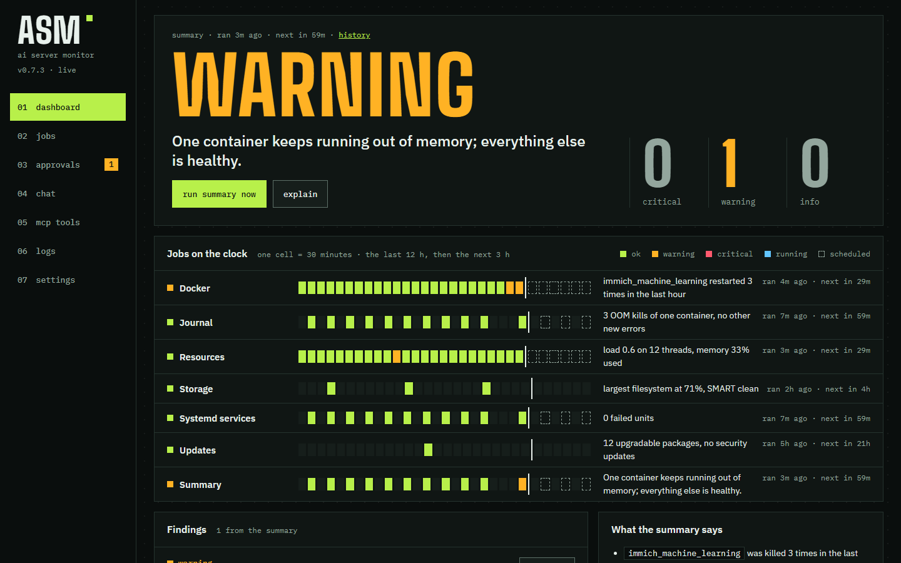
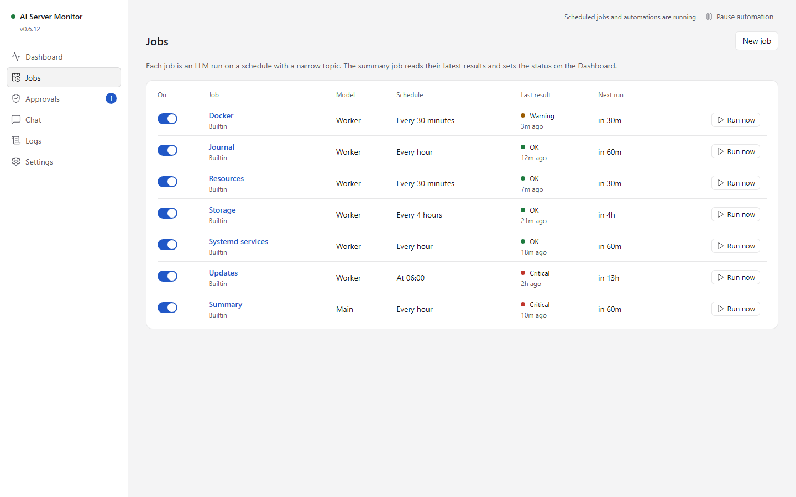
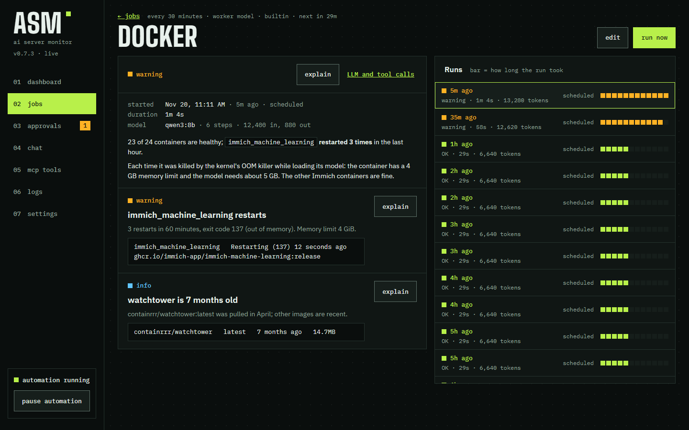
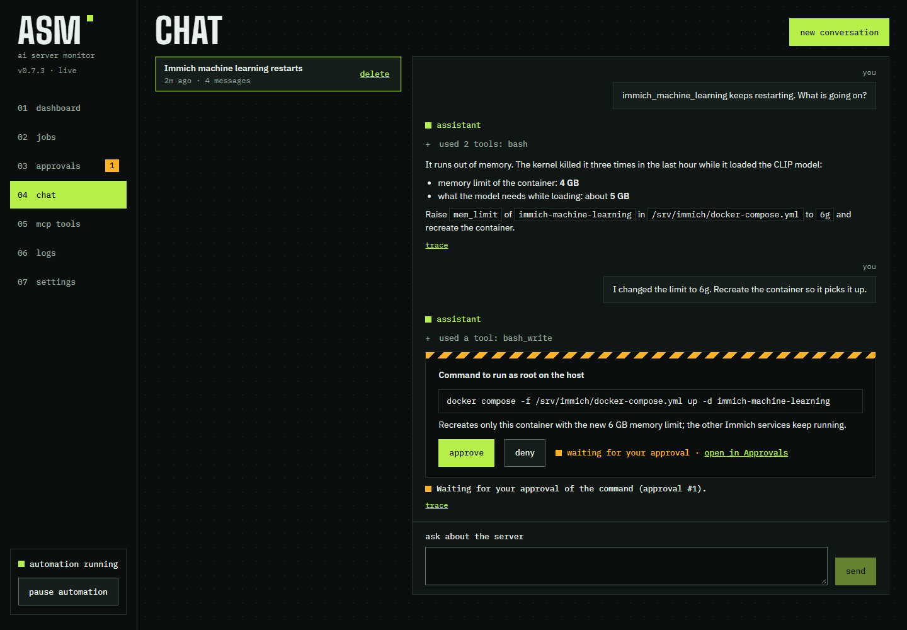

# AI Server Monitor

A self-hosted monitor for one Linux server in which **a language model does all the
monitoring**. Nothing is collected by code: scheduled LLM jobs look at the host with a read-only
shell and write down what they found, a summary job turns their results into one overall
status, and you can ask the same agent anything in chat (web page, Telegram or `/api/chat`). It
works with any OpenAI-compatible endpoint (Ollama, llama.cpp, OpenRouter, OpenAI...).

What it does:

- **Topic jobs** on a small *worker* model check one area each (disk, journal, resources,
  Docker, systemd, updates) on a schedule and store a status (`ok`, `warn`, `crit`, or `error`
  when the run failed), a short summary and findings. You can edit them and add your own.
- **A summary job** on the big *main* model reads the latest topic results and the previous
  summary, looks again where it needs to, and writes the overall status. It is the headline of
  the Dashboard, of `/api/status` and of the Telegram summary message.
- **Chat** on the main model with a read-only `bash` tool on the host, `delegate` (hands a
  sub-task to the worker model), tools to list, run and edit jobs, and the tools of the MCP
  servers you add.
- **Changes only with your approval**: when you ask the chat for a change, it proposes a root
  command (`bash_write`) or an MCP write; you approve it on the Approvals page or with a
  Telegram button, it runs, and the chat continues with the result by itself.
- **Telegram** bot (questions, `/status`, `/run`, approvals, the summary when it changes),
  **`/metrics`** for Prometheus with a Grafana dashboard, and a **Logs** page with every model
  request as sent and received.

**The models must support native tool calling** (OpenAI-style `tools`). Settings → Main model →
**Test** checks the endpoint and the model, then runs the model the way a real run does (main:
the chat's instructions and tools; worker: a topic job's) and asks it to run `echo` with `bash`.
It passes only on a real tool call; a model that writes the call as text fails the test.

- [Quick start](#quick-start) · [The compose file](#the-compose-file) · [Models](#models)
- [Jobs](#jobs) · [Using it](#using-it) · [Security model](#security-model)
- [Settings reference](#settings-reference) · [Upgrading from 0.6.x](#upgrading-from-06x)
- [Troubleshooting](#troubleshooting) · [Development](#development) · [Design notes](docs/DESIGN.md)

## Screenshots

| | |
|---|---|
| [](docs/samples/ui/dashboard.png) | [](docs/samples/ui/jobs.png) |
| **Dashboard**: the summary job's overall status, then one card per topic job | **Jobs**: turn jobs on and off, edit them, run one now |
| [](docs/samples/ui/job-run.png) | [](docs/samples/ui/chat-approval.png) |
| **A job run**: what the model found, with findings by severity | **Chat**: a change runs only after you approve the command |

## Quick start

Debian/Ubuntu (or any Linux) host with Docker and the compose plugin:

```bash
mkdir -p ~/ai-server-monitor && cd ~/ai-server-monitor
curl -fsSL https://raw.githubusercontent.com/drumslave-git/ai-server-monitor/main/docker/compose.example.yaml -o compose.yaml
docker compose up -d
```

1. Open `http://<server>:8080` → **Settings**. Changes apply on **Save**, without a restart;
   there are no config files.
2. **Main model** (`llm`): base URL ending in `/v1` (`http://ollama:11434/v1`,
   `https://openrouter.ai/api/v1`...), model name, API key if needed. Press **Test**.
3. **Worker model** (`worker`): a smaller model for the topic jobs and `delegate`. Leave it
   empty to use the main model for everything; an empty base URL means the main model's
   endpoint and key.
4. Optional: **Outputs** → Telegram (bot token, allowed chat ids) and the `/metrics` bearer
   token; **MCP servers**; **Approvals** (whether changing commands are allowed).

The jobs start on their schedules; **Jobs** → *Run now* runs one at once.

Update: `docker compose pull && docker compose up -d`. To pin a version, change the image tag
(`ghcr.io/drumslave-git/ai-server-monitor:X.Y.Z`; tags `X.Y.Z`, `X.Y` and `latest`, amd64).

**There is no built-in login.** Keep port 8080 on your LAN, or put a reverse proxy with
authentication in front of it (Authelia, oauth2-proxy, basic auth...). Whoever can reach the
port can use the chat and approve changes. The live endpoints `/api/stream` and `/api/chat` are
server-sent events; they send `X-Accel-Buffering: no`, and if your proxy still buffers them,
disable response buffering for those two paths. Over plain HTTP/1.1 (no HTTP/2 proxy in front)
every open tab holds one connection for live updates and browsers allow six per host, so with
six or more tabs open the page stalls.

## The compose file

[`docker/compose.example.yaml`](docker/compose.example.yaml), line by line:

| Line | Why |
|---|---|
| `image: ghcr.io/drumslave-git/ai-server-monitor:latest` | The app: backend and web UI in one container. |
| `container_name`, `depends_on: docker-proxy` | A fixed name for `docker logs`; the proxy starts first. |
| `restart: unless-stopped` | Comes back after a reboot. Runs that a stop interrupted are rerun about a minute after the start. |
| `pid: host` | The container sees the host's processes, so `ps`, `top` and `/proc/<pid>` in the shell show the host. Also needed to reach PID 1 for approved changes. |
| `security_opt: apparmor=unconfined` | On hosts with AppArmor (Ubuntu) Docker's default profile blocks reading other processes under `/proc`. The mounts stay read-only. Hosts without AppArmor do not need it. |
| `cap_add: DAC_READ_SEARCH` | Lets the read-only shell read root-only files (`/var/log/*`, `/root`, `du` over every directory). It reads every file and writes none. Without it the shell still works as an unprivileged user with the `adm` and `systemd-journal` groups and says when a path was unreadable. |
| `# - SYS_ADMIN` / `# - SYS_PTRACE` | Only for **approved changes**: an approved command runs as root on the host through `nsenter` into PID 1's namespaces, which needs both (measured: either alone fails). Without them the chat only reads: `bash_write` is not offered and `/api/status` (`change_shell.reason`) says what is missing. The read-only shell keeps only `DAC_READ_SEARCH` either way. |
| `ports: "8080:8080"` | Web UI, API and `/metrics`. |
| `DOCKER_HOST: tcp://docker-proxy:2375` | The shell's `docker` commands go through the socket proxy below, never the real socket. |
| `./data:/data` | Settings, jobs, runs, chats, the audit log: one SQLite file. **Back it up: it holds your API keys and tokens in clear text.** |
| `/:/host:ro,rslave` | The host's filesystem, read-only: the shell runs the host's own programs (`chroot /host`) on the host's files. `rslave` makes mounts added later visible. |
| `# gpus: all` | Uncomment to make an NVIDIA GPU visible to the shell (`nvidia-smi`; needs the NVIDIA container runtime). |
| `docker-proxy` (`tecnativa/docker-socket-proxy`) | Lets only GET requests through to the Docker socket (mounted `:ro`): containers can be listed, inspected, their logs read; nothing can be started, stopped or deleted. |
| proxy env `CONTAINERS`, `IMAGES`, `INFO`, `SYSTEM` | The API sections allowed: containers (state, stats, logs), images, engine info, disk usage (`docker system df`). |

The container needs Docker's default capabilities `CHROOT`, `SETUID` and `SETGID` for the
shell sandbox: do not add `cap_drop: ALL`. Startup parameters that are not settings (the image
defaults fit the compose file): `ASM_DATA_DIR` (`/data`), `ASM_PORT` (`8080`), `ASM_HOST`
(`0.0.0.0`), `ASM_HOST_ROOT` (`/host`), `ASM_STATIC_DIR` (the built web UI).

## Models

Two model settings, both any OpenAI-compatible endpoint:

| | Used for | Setting |
|---|---|---|
| **Main model** | chat, the summary job, chat titles | `llm` |
| **Worker model** | the topic jobs, `delegate` sub-tasks from the chat and the summary | `worker` (empty model = the main model) |

- **Native tool calling is required** for both. There is no fallback for models that cannot call
  tools. A chat answer that is only a tool call written as text (e.g. `bash[ARGS]{...}`) is sent
  back once; written like that again it is stored with a note to pick another model. Nothing
  is ever run from text.
- *Max output tokens* counts a thinking model's reasoning too: keep it at 4096 or more (default
  16384). With Ollama also raise `OLLAMA_CONTEXT_LENGTH`, or long prompts are cut silently.
- A small local model (e.g. `gemma4:e4b` on Ollama) works as the worker; give the main model
  the best model you have, since it writes the summary and talks to you.
- Cloud models: tool results (process names, container names, log lines, file contents) leave
  your network. Configured secrets and common credential formats are scrubbed first.

## Jobs

A job is a prompt for the model, a schedule (an interval or a cron line, in the host's time
zone unless `general.timezone` says otherwise) and a model. A topic run gets only `bash` and must
finish with a structured result: status, a short markdown summary and findings (`info`, `warn`,
`crit`). It must run at least one command: a result given before any is sent back once, and a
run that still ran none is stored as `error` "ran no command" (the summary is exempt: it reads
the topic results). A run that fails (model unreachable, over its time limit, no result) is
stored as `error` with the reason. Runs are kept for `storage.retention`.

Built-in jobs (edit them on the Jobs page; *Reset* brings back the release version, and
unedited ones follow later releases):

| Job | Model | Schedule | Looks at |
|---|---|---|---|
| `storage` | worker | every 4 h | disk space and inodes, biggest directories |
| `journal` | worker | every 1 h | journal errors of the last hour, kernel warnings |
| `resources` | worker | every 30 min | CPU, memory, load, GPU, temperatures |
| `docker` | worker | every 30 min | container state, restarts, health |
| `systemd` | worker | every 1 h | failed units, system state |
| `updates` | worker | daily at 06:00 | pending updates, reboot required |
| `summary` | main | every 1 h | the latest result of every enabled topic job and the previous summary; may use `bash` and `delegate` to check |

Settings → Jobs: `max_concurrent_runs` (1 = runs that come due together wait for each other,
right for one GPU), the default time limit and step limit. The chat can list, run, create, edit
and delete jobs (`jobs_list`, `job_results`, `job_run`, `job_save`, `job_delete`); a builtin can
be disabled but not deleted.

**Pause automation** (button on every page) stops the whole schedule (jobs, pruning, approval
sweeps) and cancels scheduled runs in flight. *Run now*, the chat, approvals and Telegram keep
working. It survives a restart. `GET /api/automation`, `POST /api/automation/pause|resume`.

## Using it

- **Dashboard** — the overall status and headline from the newest summary run, and one tile per
  job with its last status. **Jobs** — every job with its runs (summary, findings, error, model,
  tokens), the editor and *Run now*.
- **Explain** — on the Dashboard's summary and the run view of the Jobs page, the run as a whole
  and every finding have an *Explain* button. It opens a new chat in which the main model gets the
  run's source data (the job and what it checks, the run, its findings with their evidence, the
  commands it ran with their output, and for the summary the topic results it was given) and
  explains in detail what it means, why it matters, the likely causes, how to confirm it and what
  you can do. It may look at the current state with read-only commands; keep asking in the same
  chat. The Telegram summary message has the same button.
- **Chat** — ask about the server ("what is using the most disk?"). Answers stream in; each tool
  call is shown with its command and output. The model sees the last `chat.history_messages`
  messages of a conversation. Commands in an answer have a **Run** button: **Run** for a command
  marked `# [read-only]` (read-only shell), **Run (changes the server)** for `# [write]` and
  **Run (may change the server)** for an unmarked one (both run as root on that click, logged
  in Approvals). The model does not write these marks itself: one extra call of the main model
  labels every command without a valid mark before the answer is stored, and a mark line the
  model put outside a code block (shown as a heading) is turned into plain text.
- **Approvals** — what waits for your decision, and the permanent audit log of every action
  (`GET /api/approvals`, `GET /api/actions`, one action at `GET /api/actions/{id}`).
- **Logs** — every request to a model exactly as sent and received (messages, tool definitions,
  answer, reasoning, token counts, timings), a timeline per chat question and per job run, and
  the app's own log with a live tail. Secrets are removed from what is stored; limits are in
  Settings → Logs.
- **Telegram** — write a plain question to chat. Commands: `/status` (overall status with its
  headline, then one line per job), `/jobs` (every job: on or off, next run), `/run <job>`
  (runs it and answers when it is done), `/summary` (the same for the summary), `/approvals`
  (open requests with buttons), `/new` (fresh conversation), `/id` (this chat's id; works in any
  chat, also before it is allowed), `/help`. The summary's result (status, headline, warnings)
  goes to every allowed chat as `outputs.telegram.send_summary` says: `changed` (default),
  `every` or `never`. Each approval is one message with **Approve all** / **Reject all** (and
  **Review** when `outputs.telegram.web_url` is set); it is edited to the outcome, also when you
  decide in the web UI. A conversation starts fresh after `outputs.telegram.new_session_after`
  (6 h) of silence or with `/new`.
- **Chat API** — `POST /api/chat` with `{"message": "...", "session_id": "..."}` answers as a
  server-sent-event stream (`POST /api/chat/explain` with `{"run_id": 12, "finding": 0}` starts an
  explain conversation the same way); `GET /api/chat/sessions[/{id}]`, `DELETE /api/chat/sessions/{id}`.
  `GET /api/chat/audit` lists the commands and MCP calls the chat made. `GET /api/status`,
  `GET /api/jobs`, `GET /api/jobs/{slug}/runs` give the job picture.
- **Metrics** — `/metrics` (`prometheus_client`): job status, last run time, duration, findings
  by severity and runs by status (`asm_job_*`), LLM requests, tokens, errors and duration
  (`asm_llm_*`), pending approvals and actions by result, build info. Import
  [docs/grafana-dashboard.json](docs/grafana-dashboard.json). Scrape config:

  ```yaml
  scrape_configs:
    - job_name: ai-server-monitor
      authorization: { credentials: "<bearer token>" }   # only if you set one
      static_configs: [{ targets: ["ai-server-monitor:8080"] }]
  ```

## Security model

**The read-only shell** (`bash`, used by the jobs, the chat and `delegate`) runs the host's own
bash and programs on the read-only host mount, as a dedicated uid (2147483000) that owns no host
process, with `no_new_privs` and at most the `DAC_READ_SEARCH` capability, under `prlimit` (CPU
time, 4 GiB address space, no file writes, at most 512 processes), `nice`/`ionice` and a time
limit (`chat.command_timeout`, the model may ask for up to `chat.tool_timeout`). Measured in a
simulated host (Docker 29.8 on WSL2, `pid: host`, the compose file above; GPU commands were not
tested):

- It **can** read every file (with `DAC_READ_SEARCH`; without it, what the `adm` and
  `systemd-journal` groups may read), `journalctl`, `ps`/`top` over all host processes, the
  host's listening ports from `/proc/1/net/tcp`, and `docker ps/logs/inspect/stats/system df`
  through the proxy; pipes, subshells and redirection to `/dev/null` work. On systemd 257 or
  newer it reads the system state and the failed units from systemd's Varlink socket
  (`varlinkctl` on `/run/systemd/io.systemd.Manager`; measured on Ubuntu 26.04, systemd 259).
- It **cannot** write, delete or create any host file (read-only mount), signal any process
  (also not PID 1 or `nobody`'s), open the real Docker socket, change anything through the
  Docker proxy (403), write to devices, `/proc/sys` or `/sys`, enter other namespaces
  (`nsenter`, `unshare`) or see which process owns another user's socket (`ss -p` needs
  `SYS_PTRACE`, which the sandbox never has).
- It cannot use `systemctl`: the system D-Bus accepts the sandbox uid's authentication and
  then closes the connection at `Hello` (measured; the uid has no passwd entry on the host),
  and systemctl's direct socket `/run/systemd/private` is root-only. Giving the sandbox a
  uid with a passwd entry (`nobody`) would let it signal `nobody`'s processes, so the systemd
  job uses Varlink and the journal instead.
- The Varlink socket is open to every local user and also offers `Reload` and `Reexecute`.
  systemd guards those with polkit (`org.freedesktop.systemd1.reload-daemon`, which needs an
  administrator's authentication by default), which a sessionless sandbox cannot give; this
  was read in systemd's source, not tried on a live host. A host with a polkit rule granting
  that action to all users would let the read-only shell reload systemd (not change units).

Every command a chat runs is in `GET /api/chat/audit` and in the Logs page; a job's commands are
in its run's trace.

**Approved changes** (`approvals.shell_changes`): only the main model in chat has `bash_write`,
never the jobs or the worker model. With `approve` (default) every command waits for you on the
Approvals page and in Telegram, and expires after `approvals.approval_ttl` (1 day); with `auto`
it runs without asking; `off` removes the tool. An approved command runs **as root on the host**
(nsenter into PID 1's namespaces) and can do anything root can, so read it before you approve.
The approve button answers at once; the command runs (up to `chat.command_timeout`), its exit
code and output go into the permanent audit log, and the chat continues with them.

**MCP servers** (Settings → MCP servers): remote servers only (Streamable HTTP or HTTP+SSE, no
stdio programs), tools only. You pick which tools the chat gets; above
`mcp.max_inline_tool_tokens` it gets a generic `mcp_list_tools` / `mcp_call` pair instead. A tool
is *read* only if the server marks it `readOnlyHint` and you did not override it; reads run at
once. Everything else is a *write* under the server's policy: `off` (never), `suggest` (recorded,
never run), `approve` (default: waits for you) or `auto`, with per-tool overrides and its own
`mcp.dry_run` switch. The calls of one chat answer wait as one approval: one card in the chat
with **Approve all** / **Deny all**, a checklist on the Approvals page. **Approve for this whole
answer** also approves every later call of the same tool the model makes until that answer is
finished (a model usually asks for a few at a time, so 180 removals are one click, not 180);
each call is still listed in the card and the audit log, and the next question asks again. A
call that failed shows the server's reason in the card.

**Untrusted text and secrets**: log lines, command output and tool results are passed to the
model as delimited data; a model can only *request* an action, and your settings decide what
happens. Configured secrets, secret-looking fields and common credential formats are scrubbed
from tool results and from stored logs. Keys and tokens are stored in clear text in `data/` and
shown as `********` in the UI and API. Telegram serves only the chat ids you list, and button
presses carry a signature.

## Settings reference

Generated from the code by `python scripts/gen_settings_docs.py --write` (`--check` fails when it
is out of date). Durations are written like `30s`, `5m`, `6h`, `30d`, `1h30m`. Defaults are the
values a fresh install starts with.

<!-- settings-reference:start (generated by scripts/gen_settings_docs.py) -->

### General (`general`)

| Setting | Type | Default | What it does |
|---|---|---|---|
| `general.log_level` | debug / info / warning / error | `info` | Log verbosity of the service. |
| `general.language` | string | `en` | Language of chat answers and Telegram messages. |
| `general.docker_url` | string | empty | Docker API the shell's `docker` commands use, e.g. tcp://docker-proxy:2375 or unix:///var/run/docker.sock. Empty = $DOCKER_HOST (set by the compose file), else the local socket. |
| `general.timezone` | string | empty | Time zone of cron schedules, e.g. Europe/Berlin. Empty = the host's own time zone (its /etc/timezone or /etc/localtime), UTC when that cannot be read. |

### Main model (`llm`)

| Setting | Type | Default | What it does |
|---|---|---|---|
| `llm.base_url` | string | empty | OpenAI-compatible API base URL, e.g. http://ollama:11434/v1, http://llama:8080/v1, https://openrouter.ai/api/v1. Empty = LLM not configured. |
| `llm.api_key` | secret | empty | API key, if the endpoint needs one. |
| `llm.model` | string | empty | Model name as the endpoint knows it, e.g. qwen2.5:14b or gpt-4o-mini. |
| `llm.max_output_tokens` | integer (min 64) | `16384` | Maximum tokens per answer, counting a thinking model's reasoning too. Too low and a model that thinks long runs out before it writes the answer (shown as an error). |
| `llm.reasoning_effort` | auto / none / low / medium / high | `auto` | How much a thinking model reasons before answering chat questions, sent as the API's reasoning_effort (left out from then on if the endpoint rejects it). auto = not sent, the model decides; none = no thinking (fast, shallower); low / medium / high = as the model supports. Short helper calls (chat titles, tests) always ask for none. |
| `llm.temperature` | number or auto | `auto` | Randomness of answers: 0 is the most predictable, higher is more varied. auto = not sent, so the model's own default applies (for Ollama models it is shown above). |
| `llm.top_p` | number or auto | `auto` | Nucleus sampling: only the most likely words that together cover this share of the probability are considered. auto = not sent, the model's own default applies. |
| `llm.top_k` | integer or auto | `auto` | Only the this-many most likely words are considered at each step (0 = no limit). auto = not sent, the model's own default applies. Not every endpoint honours it. |
| `llm.timeout` | duration | `3m` | Per-request timeout. Local models on CPU can be slow. |
| `llm.max_retries` | integer (min 0, max 10) | `2` | How many times a failed model request is retried before giving up. |
| `llm.extra_body` | map | empty | Extra provider-specific request fields (JSON), passed through verbatim. |

### Worker model (`worker`)

| Setting | Type | Default | What it does |
|---|---|---|---|
| `worker.base_url` | string | empty | OpenAI-compatible API base URL, e.g. http://ollama:11434/v1, http://llama:8080/v1, https://openrouter.ai/api/v1. Empty = LLM not configured. |
| `worker.api_key` | secret | empty | API key, if the endpoint needs one. |
| `worker.model` | string | empty | Model name as the endpoint knows it, e.g. qwen2.5:14b or gpt-4o-mini. |
| `worker.max_output_tokens` | integer (min 64) | `16384` | Maximum tokens per answer, counting a thinking model's reasoning too. Too low and a model that thinks long runs out before it writes the answer (shown as an error). |
| `worker.reasoning_effort` | auto / none / low / medium / high | `auto` | How much a thinking model reasons before answering chat questions, sent as the API's reasoning_effort (left out from then on if the endpoint rejects it). auto = not sent, the model decides; none = no thinking (fast, shallower); low / medium / high = as the model supports. Short helper calls (chat titles, tests) always ask for none. |
| `worker.temperature` | number or auto | `auto` | Randomness of answers: 0 is the most predictable, higher is more varied. auto = not sent, so the model's own default applies (for Ollama models it is shown above). |
| `worker.top_p` | number or auto | `auto` | Nucleus sampling: only the most likely words that together cover this share of the probability are considered. auto = not sent, the model's own default applies. |
| `worker.top_k` | integer or auto | `auto` | Only the this-many most likely words are considered at each step (0 = no limit). auto = not sent, the model's own default applies. Not every endpoint honours it. |
| `worker.timeout` | duration | `3m` | Per-request timeout. Local models on CPU can be slow. |
| `worker.max_retries` | integer (min 0, max 10) | `2` | How many times a failed model request is retried before giving up. |
| `worker.extra_body` | map | empty | Extra provider-specific request fields (JSON), passed through verbatim. |

### Chat (`chat`)

| Setting | Type | Default | What it does |
|---|---|---|---|
| `chat.max_steps` | integer (min 1, max 60) | `15` | Most tool-use rounds of the main model per question before it must answer with what it has. A host question usually takes 3 to 8 shell commands; the rest is room for a check. |
| `chat.worker_max_steps` | integer (min 1, max 60) | `20` | Most tool-use rounds of one sub-task on the worker model. Higher than the main model's: a small model exploring with the shell needs more tries, and its steps are cheap. |
| `chat.command_timeout` | duration | `5m` | How long one shell command may run when the model does not ask for longer (it may ask for up to the tool time limit below, e.g. for a disk walk). |
| `chat.history_messages` | integer (min 0, max 100) | `12` | How many earlier messages of a conversation the model sees. |
| `chat.max_tool_result_chars` | integer (min 500, max 50000) | `6000` | Longest tool result passed to the model; bigger results are trimmed. |
| `chat.tool_timeout` | duration | `1h` | Longest one tool call (a disk scan, a command, an API call) may run before the chat gives up on it. The answer waits for the tool; the chat shows what is running and for how long. |

### Jobs (`jobs`)

| Setting | Type | Default | What it does |
|---|---|---|---|
| `jobs.max_concurrent_runs` | integer (min 1, max 8) | `1` | How many job runs may use the models at the same time. 1 suits one local GPU: runs that come due together wait for each other. |
| `jobs.timeout` | duration | `15m` | Longest one job run may take (a job can set its own). A run over it is stored as error. |
| `jobs.max_steps` | integer (min 1, max 60) | `12` | Most tool-use rounds of one job run (a job can set its own). |

### Data retention (`storage`)

| Setting | Type | Default | What it does |
|---|---|---|---|
| `storage.retention` | duration | `30d` | How long chat messages and job runs are kept. The action log is permanent. |
| `storage.prune_interval` | duration | `1h` | How often old data is deleted. |

### Logs (`logs`)

| Setting | Type | Default | What it does |
|---|---|---|---|
| `logs.llm_trace` | boolean | on | Record every request to the language model: what was sent, what came back, how long it took. Shown on the Logs page. Off = new calls are not recorded. |
| `logs.store_bodies` | boolean | on | Keep the full text of prompts, tool definitions, answers and reasoning. Off = only the numbers are kept (timings, token counts, status), and the page cannot show what was sent. Passwords, API keys and tokens are removed from stored text either way. |
| `logs.retention` | duration | `7d` | How long recorded calls and saved warnings stay. |
| `logs.max_total_mb` | integer (min 10, max 10000) | `200` | Upper limit for the recorded calls on disk; the oldest go first when it is exceeded. |
| `logs.keep_app_log` | boolean | on | Save warnings and errors of the app log in the database so they survive a restart. The Logs page always shows the newest few thousand lines since the last start. |

### Outputs (`outputs`)

| Setting | Type | Default | What it does |
|---|---|---|---|
| `outputs.telegram.enabled` | boolean | off | Turn the Telegram bot on (needs a bot token and at least one allowed chat id). |
| `outputs.telegram.token` | secret | empty | Bot token from @BotFather. |
| `outputs.telegram.allowed_chat_ids` | list of integer | empty | Only these chats may talk to the bot. Don't know a chat id? Send /id to the bot: it answers in any chat. |
| `outputs.telegram.new_session_after` | duration | `6h` | Start a fresh chat after this long without a message in a Telegram chat (the old one stays in the Chat list on the web page). 0 = never: one chat until you send /new. |
| `outputs.telegram.send_summary` | changed / every / never | `changed` | When to send the result of the Summary job to the allowed chats (status, headline and the warnings). changed = when the overall status or the list of warnings differs from the last summary; every = after every summary run; never = only on request (/summary). |
| `outputs.telegram.api_url` | string | empty | Bot API server. Empty = https://api.telegram.org. |
| `outputs.telegram.web_url` | string | empty | Address of this web UI as you open it, e.g. https://monitor.example.com. Approval messages get a "Review" button that opens the approval there. Empty = no button. |
| `outputs.metrics.enabled` | boolean | on | Expose Prometheus metrics at /metrics. |
| `outputs.metrics.bearer_token` | secret | empty | If set, scrapers must send "Authorization: Bearer &lt;token>" (Prometheus: authorization in the scrape config). Empty = open to anyone who can reach the port. |

### MCP servers (`mcp`)

| Setting | Type | Default | What it does |
|---|---|---|---|
| **mcp.servers** | list of groups | empty | MCP servers whose tools the chat may use (tools only: prompts and resources of a server are not used). |
| `mcp.servers[].name` | string | required | Short name shown in chat and in tool names, e.g. home-assistant. |
| `mcp.servers[].enabled` | boolean | on | Off = never connected, its tools are not offered. |
| `mcp.servers[].url` | string | required | MCP endpoint, e.g. http://homeassistant.local:8123/mcp_server/sse or https://grafana.example/mcp. Remote servers only (Streamable HTTP or the older HTTP+SSE); servers that run as a local program (stdio) are not supported. |
| `mcp.servers[].transport` | auto / streamable_http / sse | `auto` | auto = try Streamable HTTP, fall back to the older HTTP+SSE. |
| `mcp.servers[].token` | secret | empty | Bearer token sent as `Authorization: Bearer ...`, if the server needs one. |
| **mcp.servers[].headers** | list of groups | empty | Extra HTTP headers (for servers that want an API key header instead of a token). |
| `mcp.servers[].headers[].name` | string | required | Header name, e.g. X-Api-Key. |
| `mcp.servers[].headers[].value` | secret | required | Header value (kept secret, like the token). |
| `mcp.servers[].timeout` | duration | `30s` | Connect timeout and per-call timeout. |
| `mcp.servers[].tool_filter` | list of string | empty | The tools the agents may use. Empty = none: pick them after pressing Test. |
| `mcp.servers[].default_policy` | suggest / approve / auto | `approve` | For tools that change things: suggest = only record the request; approve = ask you first (UI / Telegram); auto = just do it. Read-only tools always run. |
| **mcp.servers[].tool_overrides** | list of groups | empty | Per-tool exceptions to the policy or to the read-only detection. |
| `mcp.servers[].tool_overrides[].name` | string | required | Tool name as the server calls it. |
| `mcp.servers[].tool_overrides[].policy` | inherit / suggest / approve / auto | `inherit` | inherit = the server's default policy; suggest / approve / auto as for the server (only used for tools that change things). |
| `mcp.servers[].tool_overrides[].kind` | auto / read / write | `auto` | auto = read-only only if the server says so; read / write = your own call. A tool treated as read runs immediately; a write goes through the action policy. |
| `mcp.dry_run` | boolean | off | Pretend: record write calls in the action log but send nothing to the servers. |

### Approvals (`approvals`)

| Setting | Type | Default | What it does |
|---|---|---|---|
| `approvals.approval_ttl` | duration | `1d` | Pending approvals expire after this. |
| `approvals.shell_changes` | off / approve / auto | `approve` | Commands that change the host, which the chat proposes when you ask for a change (restart a container, delete files): approve = each one waits for your approval (here or in Telegram) and the chat continues with the result; auto = they run without asking; off = the chat cannot change anything. They run as root on the host, which needs `cap_add: [SYS_ADMIN, SYS_PTRACE]` in compose.yaml (commented out in the example); without it the chat only reads, and the status says so. |

<!-- settings-reference:end -->

## Upgrading from 0.6.x

0.7.0 replaces the code-based collection with LLM jobs. Your settings, chats, the action audit
log and the model call logs are kept; the rest of the old data is deleted by the upgrade.

**Removed** (and its stored data):

- the \*arr (Radarr, Sonarr, Whisparr, Prowlarr) and qBittorrent integration: its settings are
  dropped, its actions still waiting are closed as expired (finished ones stay in the audit log);
- model benchmarks and their tables;
- collectors, the health score, charts, the digest and the reports: collected samples and old
  reports are deleted; the Dashboard now shows the jobs;
- the Prometheus input (the query planner), and the chat's generic HTTP API tool (`api_call`);
- the settings that only these used, plus `chat.shell`, `llm.tool_mode` and the other knobs of
  the old LLM client. Moved for you: `report.language` → `general.language`,
  `collectors.docker.url` → `general.docker_url`, the *arr approval timeout →
  `approvals.approval_ttl`, the Telegram report switches → `outputs.telegram.send_summary`.

**Do this**:

- Add to the `ai-server-monitor` service in your `compose.yaml` (or take the new example file):

  ```yaml
      cap_add:
        - DAC_READ_SEARCH
        # - SYS_ADMIN     # only to allow approved changes
        # - SYS_PTRACE
  ```

  The old `pid: host`, `apparmor=unconfined`, mounts and Docker proxy stay as they are.
- **Models without native tool calling no longer work**: the JSON-in-text and no-tools modes
  are gone. Check with Settings → Main model → **Test**, and set a worker model if you have a
  smaller one.
- Telegram: `/report` is gone; `/status` now shows the overall status and one line per job; new
  are `/jobs`, `/run <job>` and `/summary`. Reports and alerts are replaced by the summary
  message (`outputs.telegram.send_summary`).
- Metrics: the `asm_health_*`, `asm_findings`, `asm_report_*` and `asm_collector_*` series are
  gone; the jobs export `asm_job_*`. Re-import `docs/grafana-dashboard.json`.

### 0.7.1

- Built-in jobs you never edited get the new prompts by themselves. If you edited one (above
  all `systemd`, whose old prompt used `systemctl`), press *Reset* on the Jobs page to get the
  new text.
- `systemctl` cannot work in the read-only shell. The `systemd` job reads systemd's Varlink
  socket instead, which needs systemd 257 or newer; on older systems it falls back to the
  journal of PID 1.
- Warn and crit findings now quote the command output they rest on. A quote that is not in
  the output is shown as "not confirmed by command output". A model that does not finish
  within its step limit gives a run with the error "The model did not finish within N steps"
  instead of a crash.

### 0.7.2

- New **Explain** button on the summary, on every job run and on every finding (also on the
  Telegram summary message): it opens a new chat in which the main model explains it in detail
  from the run's own data. Nothing to set up.
- The built-in jobs, the chat and the worker share one set of tested host commands, and the
  `journal` and `updates` jobs run one combined command. Built-in jobs you never edited get the
  new prompts by themselves; if you edited one, press *Reset* on the Jobs page to get them.

### 0.7.3

- Every command in a chat or Explain answer has a **Run** button. The answer marks each command
  `# [read-only]` or `# [write]`: **Run** runs a read-only command in the read-only shell;
  **Run (changes the server)** (a write command) and **Run (may change the server)** (a command
  without a mark) run it as root through the change shell on that one click, with an entry in
  the Approvals audit log (decided by `user:run-button`). The result goes into the chat and the
  model answers it at once.
- The summary lists every enabled topic job with its status and one line (Dashboard and
  Telegram).

### 0.7.4

- Jobs that start together no longer fail with a database transaction error; the MCP manager
  runs on Pydantic AI; Settings → MCP servers shows the tools of each server in a table.

### 0.7.5

- Commands the model shows without a valid mark get one: after the answer is final, one more
  call of the main model labels them read-only or write, and the mark is written into the
  stored answer (Logs: purpose `chat_marks`). If that call fails they stay unmarked and the app
  log says so.
- A topic job run must run at least one command: a result given before any command is sent
  back once; a run that still ran none is stored as `error` "ran no command". The summary is
  exempt.
- Settings → Main model: the connection test works again (it failed with HTTP 422); error
  messages of the API now name the field and the problem.

### 0.7.6

- The chat and Explain prompts no longer ask the model to mark commands (it wrote the marks
  as headings outside the code blocks instead); the extra `chat_marks` call marks every command
  without a valid mark, and stray mark headings outside code blocks become plain text.

### 0.8.0

- **MCP tools in domains.** The main model sorts the tools of your MCP servers into domains
  (after a Settings test or save, at the start of a run when new tools appear, and on demand);
  renaming a server sorts its tools afresh. Every chat request is classified by the worker
  model and gets only the tools of the picked domains; the model can load further domains
  during the turn. Every job has a domain list (Jobs → Domains, with a **Classify** button),
  gets exactly the enabled tools of those domains, and fails with "missing tools" when they
  are not enough. Builtin jobs start with no domains.
- New **MCP tools** page: one card per domain with its tools (on/off, read/write, server),
  rename, describe or delete a domain, move a tool to another domain, and *Sort into
  domains…*.
- Settings → Main model / Worker model → **Test** now runs the model like a real chat turn or
  topic job (streamed, the real instructions and tools, the saved settings) and asks it to run
  `echo` with `bash`; a model that writes its tool call as text fails it. Run the test again
  for the models you use.
- A chat answer that is only a tool call written as text is sent back once; written like that
  again it is stored with a note that the model cannot use tools reliably.

### 0.8.1

- MCP tools page: the opened menus are readable in dark mode (every dropdown list now uses the
  app's own colours).
- *Move to… → New domain…* and a domain's pencil open the app's own dialog (name and
  description together; the name rule and its 24-character limit are shown while typing).
- **Select all** / **Deselect all** in each domain card and next to the filters; with a search
  or filter active both switch only the tools shown, and the page-level pair says how many.

### 0.8.2

- Every chat turn, job run and the MCP domain classification now get the current date, time
  and time zone (Settings → General time zone, the host's by default); the summary's time is
  in that zone too.
- The chat model is told to look up facts that change with its tools (loading a domain when
  needed) instead of answering from memory, and to say so when nothing can look it up.
- The domain classification sees the names of each domain's tools next to its description.

### 0.8.3

- The write calls of one chat answer wait as one card (**Approve all** / **Deny all**) instead
  of one card per call. The card lists each call's arguments, and a failed call shows the
  server's reason (failed calls first).
- **Approve for this whole answer** (chat card and Approvals page) also approves the later
  calls of the same MCP tool until that answer is finished; each one is still listed and
  audited. Not offered for root commands.
- An answer is no longer stopped after 5 rounds of approved or `auto` write calls; the chat
  step limit ends it.

## Troubleshooting

- **A job or the summary shows `error`** — open the run on the Jobs page: its error says why
  (model unreachable, timed out, no result). Settings → Main model / Worker model → **Test**.
  Thinking models need *Max output tokens* of 4096 or more.
- **"the host lacks setpriv" / root-only paths unreadable** — the sandbox uses the host's own
  util-linux tools (`setpriv`, `prlimit`, `ionice`); install them on the host. For root-only
  paths add `cap_add: [DAC_READ_SEARCH]`.
- **The chat cannot change anything** — `/api/status` → `change_shell.reason` says whether the
  policy is `off` or the `SYS_ADMIN` + `SYS_PTRACE` lines are missing.
- **Telegram does not answer** — your chat id must be in *Allowed chat ids*: send `/id` to the
  bot, and use *Send test message* under Settings → Outputs → Telegram. `docker logs` shows
  polling errors without the token.
- **An approved MCP write does nothing** — with `mcp.dry_run` on, approved calls are only
  recorded (status `dry_run`).
- **The page stops updating with many tabs open** — see the HTTP/1.1 note under
  [Quick start](#quick-start).

## Development

```bash
cd backend && python -m venv .venv && .venv/bin/pip install -e ".[dev]"   # Windows: .venv\Scripts\pip
.venv/bin/pytest && .venv/bin/ruff check . && .venv/bin/ruff format --check .
ASM_DATA_DIR=./data .venv/bin/python -m ai_server_monitor                 # API on :8080
cd ../frontend && npm install && npm run dev                                # UI on :5173, proxies /api
```

Local image: `docker build -f docker/Dockerfile -t ai-server-monitor:dev .`

After changing `backend/ai_server_monitor/config.py` run `python scripts/gen_settings_docs.py --write`.

## Releasing

The version in `backend/pyproject.toml` is the release trigger.

```bash
python scripts/release.py patch     # or minor / major / X.Y.Z — also syncs frontend/package.json
git commit -am "Release vX.Y.Z" && git push
```

On push to `main`, the **Release** workflow checks whether the current version has a tag yet;
if not, it runs CI, publishes the image to GHCR and then tags `vX.Y.Z`. Pushes without a version
bump publish nothing. **CI** (lint, tests, frontend build) runs on every push and pull request.
